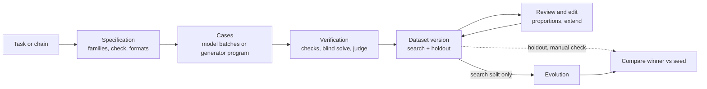

Evolution needs a dataset: task cases with reference answers that score every
candidate chain. **Autobench** (internally the *benchmark factory*, in the app
the **Datasets** screen, *Наборы данных*) builds such a dataset for a chain or
a task description, checks each case, and keeps the result as versioned
datasets you can review, edit, rebalance and hand to evolution.

:::caution[Development branch]
This section describes the dataset studio on a development branch (a draft
pull request). It is not part of a released Maestro build yet. Labels,
defaults and tool names may change before release.
:::

## The loop

1. **Specification.** One model call turns your task into a spec: goal, input
   and answer formats, success criterion, 4–8 *families* of cases (different
   decisions the agent must make, not just new names and numbers) and the check
   rule.
2. **Cases.** Either the model writes cases in batches, or it writes a small
   Python *generator program* once and the program computes every case and its
   reference answer locally.
3. **Verification.** Each case passes deterministic checks, then an
   independent blind solve and, where needed, a judge call. Only confirmed
   cases are accepted. See [Checks and verification](/care/autobench/checks/).
4. **Dataset version.** Accepted cases are stored as a version `bf_<16 hex>.v<N>`
   with a *search* part and a *holdout* part, split by family.
5. **Review.** You can edit cases, accept or exclude them, add your own,
   change family proportions and generate more for families that fall short.
6. **Evolution.** Only the search part goes to evolution. The holdout part
   stays in the local store for a final check that you currently do by hand.
   See [Use a dataset for evolution](/care/autobench/evolution/).

## Where to start

| You want to | Go to |
| --- | --- |
| Generate a dataset from the app | [Generate a dataset](/care/autobench/generate/) |
| Choose how answers are checked | [Checks and verification](/care/autobench/checks/) |
| Fix cases, rebalance, add more | [Review, edit and compose](/care/autobench/review/) |
| Evolve a chain on a dataset, or bring your own spreadsheet | [Use a dataset for evolution](/care/autobench/evolution/) |
| Set up Codex or the chat model | [Providers](/care/autobench/providers/) |
| Drive it from the agent | [Agent tools](/care/autobench/tools/) |
| Know what is tested and what is not | [Limits and status](/care/autobench/limits/) |

## Terms

| Term | Meaning |
| --- | --- |
| Run | One generation process, id `bf_<16 hex>`. Durable: survives app restarts. |
| Spec | The plan of a run. Instructions you send create new spec versions. |
| Family | A group of cases that test one kind of decision, with a difficulty and a weight. |
| Case | One input with a hidden reference answer (and optional accepted alternatives). |
| Search part | Cases evolution sees. |
| Holdout part | Whole families kept away from evolution, for a final check. |
| Version | A frozen set of accepted cases with a manifest: check, evaluator, provenance. |

## Not the same as `maestro dataset`

The TUI and CLI datasets (`maestro dataset …`, `/dataset …`) are memory cards
and a separate feature. See [CLI: dataset](/care/cli/dataset/). Autobench runs
and versions live in their own local store (see [Agent tools](/care/autobench/tools/#storage)).
