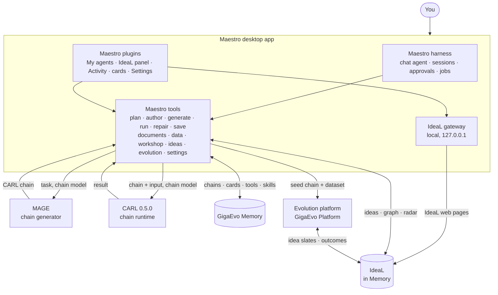

Maestro is the user-facing layer of a stack of separate modules. Each module
owns one stage of a chain's life.

| Part | Package / service | Role |
| --- | --- | --- |
| **Maestro** | `maestro-care` (import `care`) | The desktop app (harness plus Maestro plugins), the tool layer, the TUI and the CLI. |
| **Maestro harness** | bundled in `Maestro.app` | Resident chat agent: sessions, model selection, tools, approvals, background jobs. |
| **MAGE** | `mmar-mage` | Turns a task description into a CARL chain. Runs inside Maestro. In the app it is the alternative to the chat agent writing the chain. |
| **CARL** | `mmar-carl` | Executes chains: typed steps, dependencies, tools, MCP, skills. See [CARL](/carl/getting-started/overview/) and its [changelog](/carl/reference/changelog/). |
| **GigaEvo Memory** | `gigaevo-client` + Memory server | Stores chains (versioned), memory cards, tools and skills. |
| **IdeaL** | part of the Memory server | Ideas per namespace, their rating by evolution outcomes, run graphs and the radar. See [IdeaL](/ideal/getting-started/overview/). |
| **Evolution platform** | GigaEvo Platform (HTTP) | Evolves a chain on a dataset with its own mutation and validation models. |

## Inside the app

- The **harness** owns the conversation: chat, model selection, queued
  follow-ups, cancellation, the approval dialog and the job list.
- Maestro's **tools** run in a separate local process that the app starts and
  stops with the window. They own the chain rules: digest-pinned artifacts,
  input contracts, receipts, the confirmation classes.
- A private **chat-model bridge** lets MAGE and CARL call the model of the chat
  that issued the tool call. The provider key never leaves the harness. With
  a custom chain model (*development line*) they call that endpoint instead.
- The **confirmation policy** sits in front of the tools: paid work asks once,
  free actions pass. See [Confirmations](/care/app/confirmations/).
- *Development line.* The **IdeaL gateway** shows IdeaL's own web interface
  in the IdeaL panel. It listens only on `127.0.0.1`, lets in only the app's
  window (a per-launch token exchanged for a cookie), refuses foreign origins
  and adds the saved IdeaL key to requests, so the key is typed once on the
  IdeaL sign-in page and never reaches the page itself.
- *Development line.* **Attachments** are written into the session's project
  folder under `.maestro/attachments/`; the document reader extracts their
  text for the agent.

The CLI and the TUI use the same domain code but not the harness. They call
MAGE and CARL with the `CARE_MAGE__*` generator settings instead of the chat
model.

## Data flow: generate → run → save → evolve

1. **Plan.** You describe a task. The agent studies the request, attachments
   and Memory, asks for what is missing (or states assumptions) and makes a
   plan with a strategy (reuse a saved chain, write a new one itself,
   generate one with MAGE, use an artifact from this session).
2. **Build.** By default the chat agent writes the chain from Maestro's
   authoring guide, validates it, stages it and test-runs it, repairing up to
   three times. With MAGE as the author, MAGE builds the chain on the chain
   model; with memory connected it first gets a read-only recall of related
   chains (from the IdeaL catalog when IdeaL is the chain memory). Either way
   the result is a chain artifact pinned by SHA-256, with a structure card
   and a readiness summary.
3. **Run.** CARL runs exactly that artifact with your input, checked against
   the chain's input contract. Steps call the chain model (the chat model by
   default), tools, MCP servers
   or skills (skills in a sandbox, Docker by default). The run can be paused
   between steps. A failed run can be repaired: Maestro proposes a new chain
   and does not run it by itself.
4. **Save.** The chain is written to Memory as a new version and appears in
   My agents.
5. **Data.** A dataset comes from a CSV/TSV/XLSX file in the project
   folder, from examples you give in chat, or from the dataset studio, which
   creates task cases, verifies them and stores dataset versions with a search
   part and a hidden holdout part. See [Datasets](/care/autobench/overview/).
6. **Evolve.** Maestro sends the seed chain and the search part of the dataset
   to the evolution platform. With IdeaL on, the run carries the namespace and
   a stable task key: before each mutation the platform takes a slate of ideas
   from IdeaL and reports the verified outcome back. Candidates are scored by
   an exact metric or an LLM judge, on one objective or several (a Pareto
   front). Status, best score, the front and the run's IdeaL page come back
   to the app. See [Evolution](/care/workflows/evolution/).
7. **Learn.** IdeaL updates idea ratings from outcomes. The next generation and
   the next evolution of the same task start with that experience.

The best chain of a finished evolution is staged in the session as an
artifact. It is **not** written to Memory automatically; save it explicitly.

## Where state lives

| State | Where | Survives restart |
| --- | --- | --- |
| Chains, memory cards, tools, skills | GigaEvo Memory | Yes |
| Ideas, idea ratings, evolution run graphs | IdeaL (Memory server) | Yes |
| Evolution experiments | Evolution platform | Yes |
| Evolution datasets | Local SQLite (`CARE_BENCHMARK_FACTORY_DB`) | Yes |
| Attached files | The session's project folder, `.maestro/attachments/` | Yes |
| Sessions and chat history | Harness data directory | Yes |
| Maestro settings and keys | `~/.config/care/config.toml` and the app's `.env` (keys there by default, `CARE_SECRET_STORE=file`) | Yes |
| Chat-model keys | The harness's own owner-only credentials file | Yes |
| Background jobs, in-process Activity list, chain pause, run ownership | App process | No |

## Graceful degradation

Maestro imports MAGE, CARL and the platform client lazily, inside the
functions that need them. A missing optional part surfaces as a clear message,
not a crash at start. Without Memory the app still generates and runs chains;
saving and My agents are unavailable. Without a platform URL, evolution is
unavailable.

## See also

- [The desktop app](/care/app/overview/)
- [Configuration](/care/configuration/overview/)
- [Release 0.5.0](/care/reference/release-0-5-0/)
