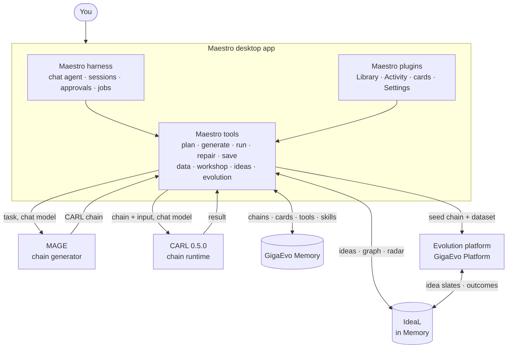

Maestro is the user-facing layer of a stack of separate modules. Each module
owns one stage of a chain's life.

| Part | Package / service | Role |
| --- | --- | --- |
| **Maestro** | `maestro-care` (import `care`) | The desktop app (harness plus Maestro plugins), the tool layer, the TUI and the CLI. |
| **Maestro harness** | bundled in `Maestro.app` | Resident chat agent: sessions, model selection, tools, approvals, background jobs. |
| **MAGE** | `mmar-mage` | Turns a task description into a CARL chain. Runs inside Maestro. |
| **CARL** | `mmar-carl` | Executes chains: typed steps, dependencies, tools, MCP, skills. See [CARL](/carl/getting-started/overview/) and its [changelog](/carl/reference/changelog/). |
| **GigaEvo Memory** | `gigaevo-client` + Memory server | Stores chains (versioned), memory cards, tools and skills. |
| **IdeaL** | part of the Memory server | Ideas per namespace, their rating by evolution outcomes, run graphs and the radar. See [IdeaL](/ideal/getting-started/overview/). |
| **Evolution platform** | GigaEvo Platform (HTTP) | Evolves a chain on a dataset with its own mutation and validation models. |

## Inside the app

- The **harness** owns the conversation: chat, model selection, queued
  follow-ups, cancellation, the approval dialog and the job list.
- Maestro's **tools** run in a separate local process that the app starts and
  stops with the window. They own the chain rules: digest-pinned artifacts,
  input contracts, receipts, the confirmation classes.
- A private **chat-model bridge** lets MAGE and CARL call the model of the chat
  that issued the tool call. The provider key never leaves the harness.
- The **confirmation policy** sits in front of the tools: paid work asks once,
  free actions pass. See [Confirmations](/care/app/confirmations/).

The CLI and the TUI use the same domain code but not the harness. They call
MAGE and CARL with the `CARE_MAGE__*` generator settings instead of the chat
model.

## Data flow: generate → run → save → evolve

1. **Plan.** You describe a task. The agent makes a plan with a strategy
   (reuse a saved chain, generate a new one, write one itself, use an artifact
   from this session).
2. **Generate.** MAGE builds a chain on the chat model. With memory connected,
   it first gets a read-only recall of related chains (from the IdeaL catalog
   when IdeaL is the chain memory). The result is a chain artifact pinned by
   SHA-256, with a structure card and a readiness summary.
3. **Run.** CARL runs exactly that artifact with your input, checked against
   the chain's input contract. Steps call the chat model, tools, MCP servers
   or skills (skills in a sandbox, Docker by default). The run can be paused
   between steps. A failed run can be repaired: Maestro proposes a new chain
   and does not run it by itself.
4. **Save.** The chain is written to Memory as a new version and appears in
   the Library.
5. **Data.** The evolution data generator creates task cases for the chain,
   verifies them and stores dataset versions with a search part and a hidden
   holdout part. See [Evolution data](/care/workflows/data-generation/).
6. **Evolve.** Maestro sends the seed chain and the search part of the dataset
   to the evolution platform. With IdeaL on, the run carries the namespace and
   a stable task key: before each mutation the platform takes a slate of ideas
   from IdeaL and reports the verified outcome back. Status, best score and
   the radar come back to the app. See [Evolution](/care/workflows/evolution/).
7. **Learn.** IdeaL updates idea ratings from outcomes. The next generation and
   the next evolution of the same task start with that experience.

The best chain of a finished evolution is staged in the session as an
artifact. It is **not** written to Memory automatically; save it explicitly.

## Where state lives

| State | Where | Survives restart |
| --- | --- | --- |
| Chains, memory cards, tools, skills | GigaEvo Memory | Yes |
| Ideas, idea ratings, evolution run graphs | IdeaL (Memory server) | Yes |
| Evolution experiments | Evolution platform | Yes |
| Evolution datasets | Local SQLite (`CARE_BENCHMARK_FACTORY_DB`) | Yes |
| Sessions and chat history | Harness data directory | Yes |
| Background jobs, in-process Activity list, chain pause, run ownership | App process | No |

## Graceful degradation

Maestro imports MAGE, CARL and the platform client lazily, inside the
functions that need them. A missing optional part surfaces as a clear message,
not a crash at start. Without Memory the app still generates and runs chains;
saving and the Library are unavailable. Without a platform URL, evolution is
unavailable.

## See also

- [The desktop app](/care/app/overview/)
- [Configuration](/care/configuration/overview/)
- [Release 0.5.0](/care/reference/release-0-5-0/)
