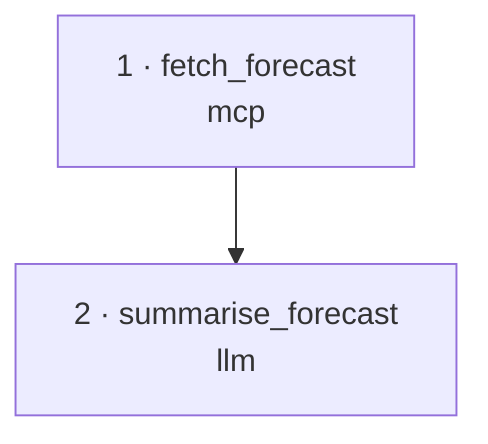

Maestro ships two agent skills with the same name, `maestro`, for two different
hosts:

| Skill | Where it runs | Drives Maestro through |
| --- | --- | --- |
| **Portable CLI skill** | Claude Code, Codex, hermes, OpenClaw, CI | The `maestro` command line |
| **Native app skill** | The agent inside the Maestro desktop app | The app's own Maestro tools |

## The portable CLI skill

An [agentskills.io](https://agentskills.io)-format bundle that teaches an external
agent to drive Maestro from the [command line](/care/cli/overview/): generate, revise,
compose and run chains, browse and version Memory, build datasets, evolve, deploy,
configure STARM solvers, and **interpret & visualize** chains, without hardcoding any
path to Maestro.

:::tip[Install in one command]
```bash
uvx maestro-install skill
```
Unpacks the skill for Claude Code, Codex, hermes or OpenClaw (pick with `--agent`).
Full steps: [Install & Use](/care/skill/install/). Direct bundle:
[`maestro.skill`](https://airi-maestro.github.io/care-docs/maestro.skill).
:::

### What's in the bundle

```
maestro/
├── SKILL.md                      # when to trigger, command map, workflows, IdeaL, STARM
├── scripts/
│   ├── care.sh                   # portable launcher that locates the CLI
│   └── viz_chain.py              # chain JSON → Mermaid graph + steps table
└── references/
    ├── commands.md               # every subcommand and flag (release 0.5.0)
    ├── production-and-tui.md     # Interactive vs Production, TUI slash commands
    ├── chain-format.md           # chain JSON: step types, references
    ├── interpret.md              # interpret & visualize a chain
    └── integration.md            # embedding into hermes / CI / other hosts
```

### What it lets the agent do

| Area | Commands |
| --- | --- |
| **Generate / edit / run** | `generate`, `revise`, `compose`, `run` (preflight or `--execute` with `--input` / `--file`), `replay`, export to `.json` / `.py` |
| **Memory & versions** | `memory ls/show/history`, `search`, `diff`, `lineage`, `favourite`, `versions`, `promote`, `rollback`, `forget`, `remember`, `notes` |
| **Validate / move** | `validate`, `import [--apply]`, `export` bundles |
| **Measure & improve** | `dataset add/list/run/export`, `evolve … --wait --accept`, `catalog`, `marketplace` |
| **Ship** | `deploy`, `deployments`, `metrics` |
| **Setup / diagnostics** | `doctor` (incl. STARM probes), `init`, `migrate-secrets` |

It also carries the knowledge that makes those commands reliable: never call
`maestro` without a subcommand (that opens the app window), which commands lack
`--json`, that `revise` and `compose` only preview without `--yes`, that a fresh
Memory's `search` index may be empty (use `memory ls --q`), absolute file paths, the
honest list of interactive-only actions (`/upload`, the gated `/promote`, IdeaL work
in the app), and to talk to users in Maestro terms rather than internal component
names.

### Interpret & visualize

After a chain is generated, the skill's first offer is to **interpret & visualize**
it: render the dependency graph with the runtime's own `to_mermaid` (plus
critical-path and token / latency / cost heatmaps when given a run) and walk every
step in plain language. The agent does the interpreting, so it works without a model
key. A two-step weather chain, for example:



The next offers are to run the chain on a sample input, revise it in words, or evolve
it.

### IdeaL from the CLI skill

The CLI has no IdeaL subcommands. The skill tells the agent to prefer the desktop app
for idea work, how to fetch a run's signed radar link with an API key, how to connect
the lake to an agent over MCP, and the rules that keep idea ratings honest (English
text, cite only applied ideas, report control mutations, no test answers or secrets).

### Portable by design

`scripts/care.sh` resolves the CLI the same way everywhere:

1. a global `maestro` (or older `care`) on `PATH`, which
   [`uvx maestro-install`](/care/getting-started/quick-start/) installs as a shim;
2. a local checkout via `$CARE_HOME` or common locations (`uv run --frozen` when a
   lockfile exists);
3. the published package: `uvx --from maestro-care maestro`.

With none of these present it prints an actionable hint instead of failing silently.

## The native app skill

The desktop app's agent preset mounts its own `maestro` skill. It works only with the
app's typed Maestro tools, never the CLI, and uses the chat model connection the app
already has. It covers:

- **Chains**: capability check (`maestro_capabilities`), a plan
  (`maestro_agent_plan`), generation as a background job, inspecting the generated
  artifact, execution, and at most one repair proposal after a failed run.
- **Evolution**: staging a seed chain and a real dataset, finding them by name
  (`maestro_find_artifacts`), lab plan and start, reading the result.
- **IdeaL**: seeding ideas for a task with `maestro_ideal_graph`,
  `maestro_idea_check`, `maestro_idea_translate` and `maestro_idea_save` after the
  user approves the list; editing and archiving ideas; the run radar
  (`maestro_ideal_run_radar`), a chain's runs (`maestro_ideal_chain_runs`) and
  forcing an idea into a running evolution (`maestro_ideal_run_force`); new tools go
  through the tools workshop (`maestro_capability_draft` → `maestro_capability_save`).

Paid actions (generation, repair, execution, evolution start) ask once through the
app's own dialog. The native skill is part of the app; it is not installed with
`maestro-install skill`.
