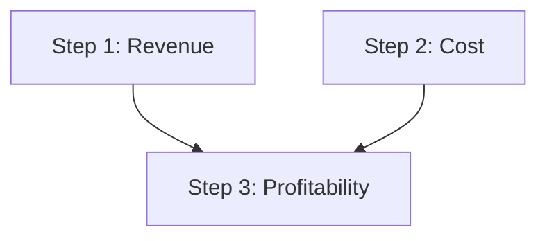

A few ideas explain almost everything in CARL.

## ReasoningChain

A **chain** is a list of step descriptions plus execution settings
(`max_workers`, `fail_fast`, search config, metrics, RE-PLAN policy, timeout,
embedded chain tools). It is the main public API and serializes to and from JSON.
See [ReasoningChain](/carl/chains/overview/).

## Steps

Each **step** is a typed description of one unit of work. All steps share
`number`, `title`, `dependencies`, `triggered_by`, `metrics`, `cache`,
`loop_back_to` / `loop_config` and the RE-PLAN checkpoint fields, and add a
type-specific config. There are 25 step types, from a single LLM call to a
bounded agent loop or a sandboxed command. See the
[steps overview](/carl/steps/overview/).

## DAG-based parallel execution

Steps declare `dependencies=[...]`. The **DAGExecutor** groups them into batches:
steps with no unmet dependencies run first, in parallel; later batches wait only
for what they depend on.

```python
LLMStepDescription(number=1, title="Revenue analysis", aim="...", dependencies=[])
LLMStepDescription(number=2, title="Cost analysis",    aim="...", dependencies=[])
# Step 3 waits for both 1 and 2:
LLMStepDescription(number=3, title="Profitability",    aim="...", dependencies=[1, 2])
```



Steps can also wait for **events** (`triggered_by`), and a conditional step
skips the branches it does not take.

Parallel steps work on copy-on-write views of memory. A sibling's writes are not
visible inside the same batch; after the batch they are merged in step order
(the highest-numbered step wins on the same key). See [memory steps](/carl/steps/memory/).

A failed step does not stop the chain unless you turn on
[fail-fast](/carl/chains/run-controls/).

## Context extraction

An LLM step can declare `step_context_queries`. For each query CARL searches your
`outer_context` (substring or vector search) and injects the matching snippets
into that step's prompt, so each step sees only the context it needs.

## ReasoningContext and ReasoningResult

The **context** carries execution state:

- the input: `outer_context` (text for prompts) and, optionally,
  `runtime_input` (structured host input for references such as
  `$outer_context.user.city`);
- the LLM client (`api`), `language`, `system_prompt`;
- history, namespaced memory, events, metadata;
- the tool registry and callbacks;
- host authority: `command_policy`, command capabilities, `code_execution_policy`,
  the network enforcer, the human-input provider;
- run controls: pause, resume, cancel.

Running a chain returns a **ReasoningResult** with `success`,
`get_final_output()`, per-step results, token usage, `metadata` and an
execution trace.

## The chain requests, the host decides

A serialized chain is input, never authority. Chain JSON can name a tool, a
command, a code profile or a sandbox. Whether it may run is decided by objects
the host attaches to the context at run time, and these are never serialized.
`chain.preflight(context)` tells you what is missing before you run.

:::tip
Dynamic references let later steps read earlier output: `$history[-1]`,
`$memory.namespace.key`, `$outer_context.field`, `$steps.1.result_data`, and
more. See [dynamic references](/carl/chains/dynamic-references/).
:::
