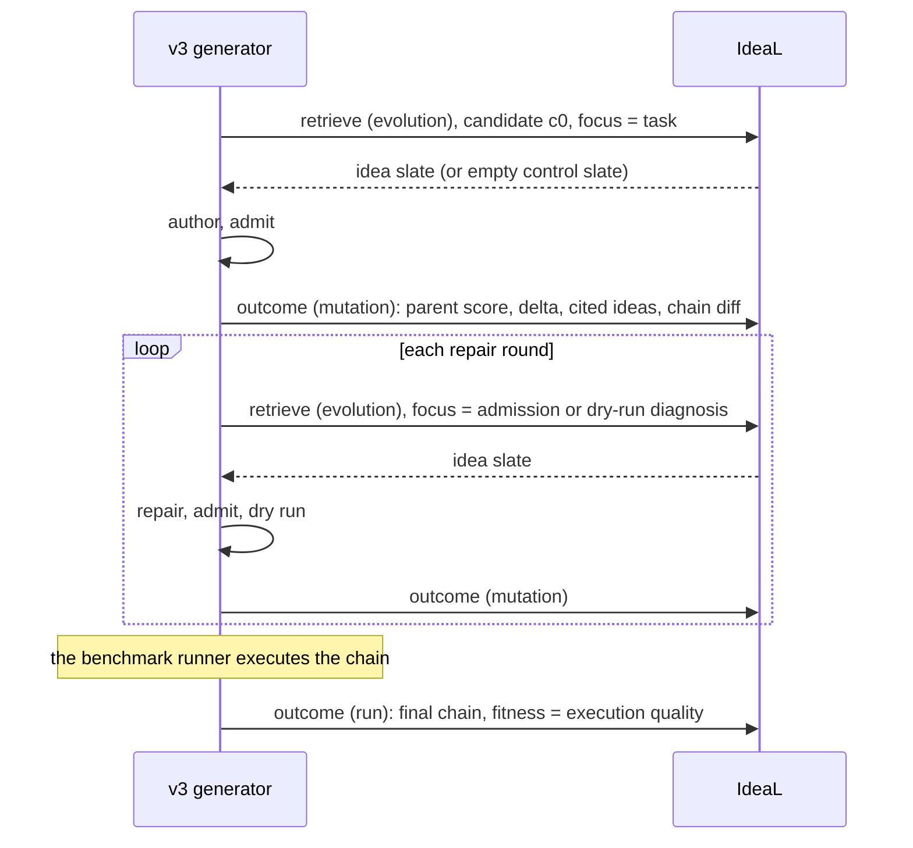

:::caution[Experimental]
Branch `feat/v3-ideal-loop` (commit ceaf38b, 2 November 2026), module
`mmar_mage/ideal_loop.py`, merged into the 0.2.0 candidate. Plugged into the
[v3 generator](/mage/concepts/v3-generator/) only from the MAGEBench arms in
`evaluation/`; the shipped `generation_strategy="v3"` does not use it. Tested offline against a fake IdeaL server; not
measured, not released. What Maestro does with IdeaL today is described in
[Memory and reuse](/mage/concepts/memory/#maestro-recall-by-the-host-ideal-hints).
:::

## The idea

[IdeaL](/ideal/getting-started/overview/) already learns from evolution: before
each mutation it hands out a slate of ideas, after the mutation it records the
score change, and it rates ideas by those outcomes. The loop treats one
generation the same way:

| Evolution | Generation |
| --- | --- |
| A run | One generation of one task |
| A mutation | One authoring or repair attempt (a candidate) |
| The mutation's score change | The candidate's self-check score |
| The run's best chain | The final chain, with its execution quality as fitness |

No new server endpoints are needed. The server's own control arm (a share of
slates deliberately left empty) is what lets it compare "with ideas" against
"without ideas", for generation exactly as for evolution. See
[Rating and outcomes](/ideal/concepts/rating/).

## One generation

- Every generation opens with an evolution retrieve, even when no idea is
  wanted: the server scopes a mutation outcome to a namespace and task only
  through the run that retrieve registers.
- Ideas are focused by the task description at `c0` and by the diagnosis at
  repairs (`memory_loop_ideas_by: diagnosis`, the default), or always by the
  task (`query`).
- **Score of a candidate**: 0 if it was not admitted, 0.5 if admitted, and
  0.5 + 0.5 × the share of passed dry-run fixtures after a dry run. Only self
  checks feed this score; the benchmark grader never does.
- After execution the run outcome stores the final chain tagged with its task,
  so the catalog can return it to the next generation of the same task. That
  is what the [reuse ladder](/mage/concepts/memory/#experimental-generation-memory-and-the-reuse-ladder) reads.
- A memory failure never fails a generation. Every call and its error is kept
  in the trace (`memory_loop.calls`).

## Settings

Per benchmark arm:

| Field | Default | Meaning |
| --- | --- | --- |
| `memory_loop` | `off` | `local`: reuse ladder only. `ideal`: reuse ladder plus IdeaL rounds. |
| `memory_loop_store`, `memory_loop_namespace` | unset | IdeaL base URL and namespace. |
| `memory_loop_chain_store` | `local` | Where proven chains live: a local JSON store or IdeaL (run outcomes and the catalog). |
| `memory_loop_learn` | `true` | `false` freezes the lake: ideas are delivered, nothing is posted. |
| `memory_loop_ideas_by` | `diagnosis` | Or `query`. |
| `memory_loop_ideas_k` | `3` | Ideas per slate shown to the author. |
| `memory_loop_reuse`, `memory_loop_ideas` | `true` | Switch the ladder or the ideas off. |
| `memory_loop_exact_min_fitness`, `memory_loop_near_min_similarity`, `memory_loop_near_min_fitness` | `0.999`, `0.8`, `0.999` | Reuse thresholds. |
| `memory_loop_near_mode` | `adapt` | Or `reuse_if_admits`, which returned an outdated answer in a live test and is no longer the default. |

The IdeaL key is read from `IDEAL_API_KEY` (header `X-API-Key`).

## Server assumptions

The loop was written against the IdeaL server branch `feat/ideal-v0`
(commit 210d2f1) by reading its code. It calls `POST /v1/ideal/retrieve`
and `POST /v1/ideal/outcome`. This was not checked against the IdeaL API
documented in [API reference](/ideal/api/reference/).

- Idea extraction from outcomes runs only if the server has extraction and a
  lake LLM configured; it is off by default.
- Search is English-only, so the study's seed lake is in English.
- Namespaces are created by the first write.

## See also

- [Memory and reuse](/mage/concepts/memory/)
- [IdeaL: evolution and the lake](/ideal/maestro/evolution/)
