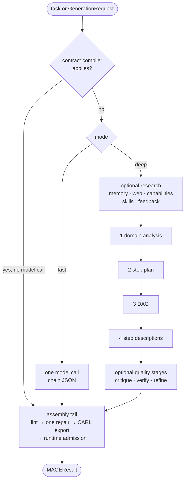

This page describes the `legacy` path of `MAGEGenerator.generate()`. It is
the default in 0.1.3 and in the revisions Maestro pins, so it is what
Maestro runs today. In the 0.2.0 candidate it is no longer the default: there
`MAGEConfig()` runs `v3`, and the legacy path needs
`generation_strategy="legacy"` (`mage generate --strategy legacy`). See
[v3 strategy](#v3-strategy) below and [v3 generator](/mage/concepts/v3-generator/).

## Contract compiler

**Development line.** Before any model call, MAGE checks whether the request
leaves nothing to decide: exactly one authoritative, runtime-bound tool, an
exact output contract with `value_source="single_tool_output"`, a tool output
schema equal to that contract, and a deterministic binding for every required
argument. Then it writes a one-step `tool` chain itself. Anything ambiguous
falls through to the normal pipeline. Switch: `enable_contract_compiler`
(on).

## Fast mode

**Released.** `mode="fast"`: one model call with a few-shot prompt returns
the chain, with retries (`max_retries`, default 2). It then goes through the
same assembly tail as deep mode. Stage name: `fast_generation`.

## Deep mode

**Released** (the default mode of the legacy strategy). Four model stages, each with a deterministic
fallback when switched off:

| Stage | Output | Switch (default) |
| --- | --- | --- |
| `domain_analysis` | Domain, task type, complexity, key concepts. | `enable_domain_analysis` (on) |
| `step_planning` | An ordered list of planned steps. | `enable_step_planning` (on) |
| `dag_building` | Dependencies and a topology. | `enable_dag_optimization` (on) |
| `step_describing` | Full CARL fields per step. | `enable_step_descriptions` (on) |

Everything else in deep mode is **off by default**. The stages exist in code
and can be switched on in `MAGEConfig`, but no internal measurement has shown
that they improve chains. Turn them on only with your own evaluation; most of
them add model calls.

| Group | Stages | Switches |
| --- | --- | --- |
| Research (run in parallel, before planning) | `memory_research`, `web_research`, `capability_lookup`, `template_assembly`, `feedback_recall`, skill discovery | `enable_memory_research`, `enable_web_research`, `enable_capability_lookup`, `enable_template_assembly`, `enable_feedback_loop`, `enable_skill_discovery` |
| Planning extras | `needs_analysis`, `topology_selection`, `tot_planning`, `tool_synthesis`, `demo_bootstrap`, `fast_path` routing | `enable_needs_analysis`, `enable_topology_selection`, `enable_tot_planning`, `enable_tool_synthesis`, `enable_demo_bootstrap`, `enable_fast_path_routing` |
| Construction | `mcts_construction` | `enable_mcts` |
| Quality | `step_critique`, `chain_verification`, `self_refine` | `enable_step_critique`, `enable_chain_verification`, `enable_self_refine` |
| After assembly | `execution_feedback`, `benchmark_mode` | `enable_execution_feedback`, `enable_benchmark_mode` |

An optional stage that fails reports `on_error` and generation continues.
Budget and cancellation errors always stop it.

## Assembly tail

Every chain, from any mode, ends here before it is returned:

1. **Lint.** Deterministic checks: tool steps name tools from the catalogue,
   bindings point at declared dependencies, `$history` and `$steps`
   references resolve, transforms are executable, the terminal step matches
   the output contract.
2. **One repair.** A lint failure goes back to the model once with the
   findings. The repaired chain is kept only if it passes lint.
3. **CARL export.** `to_carl_compat()` lowers MAGE's flat authoring fields
   into each step's `step_config`, and `eval` and `aggregator` into `llm`.
   `reindex_history_refs()` rewrites `$history[N]` from step numbers to the
   positions the runtime uses.
4. **Runtime admission** (development line). `validate_runtime_chain()`:
   strict schema, lint, and a typed load by the installed `mmar_carl`.
   Unresolved `$history` warnings become errors. A chain that fails raises
   `MAGEValidationError`; nothing is returned or saved.
5. **Naming.** A short display name, description and tags. A heuristic name
   always; with `enable_suggested_naming_llm` (on) one more model call in
   deep mode may replace it.
6. **Persistence.** Only for a plain string task or
   `PersistencePolicy(mode="safe_projection_only")`, with `enable_memory` on
   and nothing private in the planning prompt. See
   [Memory and reuse](/mage/concepts/memory/).

In 0.1.3 the tail already grounds tool names, reindexes `$history` and
lints splices; step 4 is new on the development line.

## Semantic strategy

**Development line, opt-in.** With `generation_strategy="semantic"` (env
`MAGE_GENERATION_STRATEGY`), `generate()` delegates to `compile()`. The model
only interprets the task and drafts an abstract action graph of one to six
actions, which it may revise once. Deterministic code binds capabilities,
lowers the graph to CARL and runs the same tail. Readiness is then certified
against the `RuntimeEnvironmentFeatures` the host declares; with no
declaration the result fails closed.

`compile()` returns one typed outcome instead of raising:

| Outcome | Meaning |
| --- | --- |
| `ReadyChain` | `result` (a `MAGEResult`) and a `readiness` report. |
| `NeedsUserInput` | `requirements`: missing input, capability, credential, runtime feature, permission or clarification. |
| `Unsupported` | `reasons` the task cannot be compiled. |

`compile()` never writes Memory. Maestro uses the `legacy` strategy.

## v3 strategy

**0.2.0 candidate, the default there.** With `generation_strategy="v3"`,
or with no strategy set on 0.2.0, `generate()`
skips the modes and the optional stages above, and the tail's repair and
CARL export: the v3 chain is already final CARL JSON. It runs the
v3.4 pipeline from `mmar_mage/authoring/`: a data-flow plan, one author call
that writes CARL, a deterministic compiler, admission with up to
`v3_max_repairs` repairs, and a dry run in real CARL with the declared tools
simulated. The final chain passes the same lint and `validate_runtime_chain`
admission, including `allowed_step_types`, gets a heuristic name, and persistence follows the rule in step 6
of the tail. Use the
legacy strategy for tasks with private runtime input: v3 rejects every `llm`
step there. Details, limits and what stays experimental:
[v3 generator](/mage/concepts/v3-generator/). Maestro pins an older MAGE
and does not use it.

## Budgets and cancellation

**Development line.** Hard per-generation limits in `MAGEConfig`:
`max_llm_calls`, `max_input_tokens`, `max_output_tokens`, `max_total_tokens`,
`max_wall_time_seconds`, `max_cost_usd`. MAGE fails with `MAGEBudgetError`
before it would exceed one. With a token or cost budget active, a failed
provider attempt has unknown usage, so retries and fallbacks are disabled.

Pass an `asyncio.Event` as `cancel`; it is checked between stages and before
model calls, and MAGE raises `MAGECancelledError`.

## See also

- [Typed requests and admission](/mage/concepts/typed-authoring/)
- [Python API](/mage/integration/python-api/): progress callbacks and stage names.
- [CARL dynamic references](/carl/chains/dynamic-references/)
