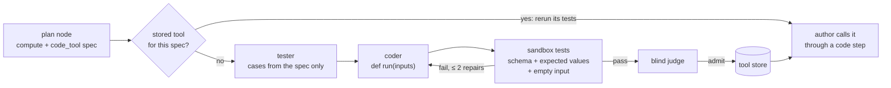

:::caution[Experimental]
Both forges are on development branches (merged into the 0.2.0 candidate)
and plug into the [v3 generator](/mage/concepts/v3-generator/) only from the
MAGEBench arms in `evaluation/`. `MAGEGenerator` does not use them, also not
with `generation_strategy="v3"`. Neither is released.
:::

A chain often fails not because the plan is wrong, but because a step has to
do something a language model does badly: call a real API, or compute an
exact number from a file. Both forges add a tested capability before the
author writes the chain, instead of hoping an `llm` step gets it right.

Both follow the same rule: **tests before admission, and a blind judge**. The
judge does not see who wrote the tool, only its contract, inputs and outputs.

## API tool forge

Package `mmar_mage/forge/`, arm field `forge_enabled`, since 9 October 2026.

1. **Need.** The plan marks a capability the declared tools do not cover.
2. **Sources.** A local catalogue, APIs.guru (OpenAPI specs), the official
   MCP registry and an optional web search hook. Sources return metadata
   only; nothing is installed or run at this point.
3. **Selection.** BM25 ranking to a shortlist, then a choice of one operation.
4. **Adapter.** A read-only HTTP tool from one OpenAPI `GET` operation, or a
   remote MCP server's tool (executed with CARL's native MCP client when the
   `mcp` SDK is installed).
5. **Tests.** Proposed test calls, recorded as cassettes so reruns do not hit
   the network.
6. **Judge.** A blind review of the recorded behaviour, then admission into
   the capability list the author sees.

:::note[What was measured]
First measurement, 9 October 2026, on a small suite of tasks without tools:
search and selection picked the right API and operation, but the forge did
not work end to end. The causes found were engineering defects (network
retries, a judge shown truncated responses, tests built from the wrong
fields, a dry run that simulated the tool instead of calling it). No new
measurement since.
:::

## Code-tool forge

Module `mmar_mage/code_forge.py`, arm field `code_forge`, commit acf7091
(2 November 2026). Hypothesis H5 of the memory study: a missing exact
computation is forged once and reused across a task family.

1. The planner marks exact computation over supplied data as a `compute` node
   with a `code_tool` spec: name, general purpose, typed inputs and outputs.
2. **Tests first.** A tester call that never sees code writes cases with exact
   expected outputs from the spec alone.
3. **Code.** A coder call writes one pure `def run(inputs)`, standard library
   only.
4. **Sandbox tests.** Every case plus an empty-input case runs in CARL's code
   step sandbox. Output must validate against the tool's schema and match
   the expected values. Failures go back to the coder (two repairs by
   default).
5. **Judge.** Checks that the inputs carry enough data, that the code derives
   the outputs (no answers copied from tests) and handles the general case.
   It may excuse at most one wrong expectation. If it blames the
   specification, the forge stops and the node goes back to the author.
6. **Store and reuse.** An admitted tool goes to a local JSON store or to
   IdeaL as a `tool` entity (tool key `mage-code:<name>`, runtime
   `carl-code`, artifact files `run.py` and `tool.json`, checked by hash on
   read). Later tasks get a card per stored tool.

In the chain, the author calls the tool with a `code` step whose source is
`$memory.tools.<name>`. The compiler inserts the tested program as a
`memory` write step, so the chain carries its own code and stays
self-contained when reused. After execution the runner counts uses and
successes; a tool used twice without a success is demoted.

Defaults (`ForgeSettings`): at most 2 tools and 10 model calls per
generation, 2 repairs, 300 s, judge on. The forge has its own model client
and budget, separate from the generation's.

### Runtime facts it relies on

- A CARL `code` step accepts only context references in `input_mapping`, so
  the compiler moves every constant argument into a separate memory write
  step.
- The program cannot be inline: `source` must be a reference, so it lives in
  a memory write step that runs first and is never the final step.
- The IdeaL catalog returns at most one tool per query, and IdeaL keeps tool
  code only as an artifact in the server's git store. Without a configured
  store the write fails and the tool stays in the local mirror.

### Sandboxes

| Runtime | Use |
| --- | --- |
| `docker` | Measurements. No network, read-only, 256 MB, 1 CPU, 32 processes. |
| `local-seatbelt` | macOS development only: `sandbox-exec`, no network, writes only in the workspace, secret directories unreadable. Wall time enforced; CPU, memory and process limits are not. |
| `local-double` | Plain subprocess, unit tests only. |

:::note[What was measured]
Nothing yet. The forge ran end to end on a handful of development tasks with
a strong model, which solved them with or without the forge, so these runs
show the pipeline works, not that it helps. A measurement needs Docker and
paid model calls.
:::

## See also

- [CARL code step](/carl/steps/code/)
- [IdeaL tools and graph](/ideal/concepts/tools-and-graph/)
