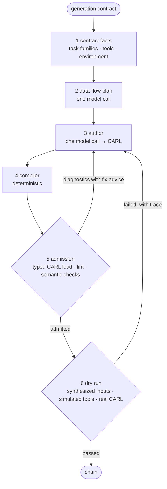

:::caution[0.2.0 candidate, opt-in, smoke-tested only]
`MAGEConfig(generation_strategy="v3")` runs the v3.4 generator from
`mmar_mage/authoring/`. It is in the `mmar-mage` 0.2.0 candidate (branch
`prep/mage-0.2.0`, draft PR `Glazkoff/carl-mage#21`), which is **not on PyPI
yet**. The default strategy stays `legacy`. The shipped strategy was checked
with offline tests, a scripted smoke test of the wheel and a live smoke run on
a Codex model; it was not re-measured on MAGEBench. Live smoke on 2026-11-13 with a local Codex CLI model (`gpt-6-luna`; smoke, not a measurement): through `MAGEGenerator` and executed in CARL 0.5.2, 3 of 3 host tasks gave correct answers; the benchmark arm on 7 lite tasks generated and admitted 7 of 7, and 3 of 7 passed scoring. Maestro does not use it. Generation memory, the IdeaL loop
and the tool forges are still experimental, see
[What stays experimental](#what-stays-experimental).
:::

v3 replaces deep mode's four fixed stages with a short, general process: plan
the data flow, let one author call write CARL, then check the result with
deterministic code and a dry run in the real CARL runtime.



## Stages

1. **Contract facts.** From the generation contract only: task families
   (editing, evidence, closed-world, files, tools, privacy), declared tools
   and MCP servers, and the environment (for example whether a human can
   answer `human_input`). Each family adds a short guide to the prompt.
2. **Data-flow plan.** One call names the few nodes the answer needs, what
   each consumes and produces, and which declared tool it calls. A node that
   nothing consumes is not allowed, so the plan is minimal by construction.
   If the plan call fails, authoring goes on without a plan.
3. **Author.** One call maps the nodes to CARL steps, guided by step cards
   and the step types the installed CARL can load.
4. **Compiler.** Deterministic: strips model overrides (`llm_config`),
   normalises references (`$steps.N.result.x` → `$steps.N.result_data.x`),
   removes dead steps, fits the final step to the output contract or to the
   answer format the request names.
5. **Admission and repair.** Typed CARL load, lint and general semantic
   checks. Every finding carries concrete fix advice and goes back to the
   author, up to `v3_max_repairs` times (3).
6. **Dry run.** Test inputs are synthesized from the contract, declared tools
   are simulated by the model from their schemas, the chain runs in real
   CARL, and the run is checked deterministically. A failed dry run becomes
   one more repair round with the execution trace. Real host tools are never
   called; a chain with a step the dry run cannot simulate is not run. An
   optional reviewer in a fresh context can judge the answer; it is off in
   v3.4.

The shipped defaults are the measured **v3.4**: one dry-run round on two
test inputs, up to two dry-run repairs, reviewer off, temperature 0. The
fields are listed in [Configuration](/mage/integration/configuration/#v3-strategy).

## Enabling it

```python
from mmar_mage import MAGEConfig, MAGEGenerator

generator = MAGEGenerator(MAGEConfig(generation_strategy="v3", api_key="sk-..."))
result = await generator.generate(request, capabilities=..., runtime_features=...)
```

A full example with a tool and an output contract is in the
[Quick start](/mage/getting-started/quick-start/#generate-with-the-v3-strategy).
`MAGE_GENERATION_STRATEGY=v3` works through `MAGEConfig.from_env()`; the
`mage` CLI has no option for the strategy.

What `generate()` does with `generation_strategy="v3"`:

- **Contract.** `build_v3_contract(request, capabilities, runtime_features)`
  turns the `GenerationRequest` into the contract v3 reads, under the
  request's egress policy: project instructions, personal preferences and
  retrieved context enter only when the policy allows it, local paths and
  hashes of attached files never do, and fields marked
  `x-mage-data-classification: private` are not named. A plain string task is
  treated as a request with `runtime_input_schema={"type": "string"}`.
- **Closed world.** `capabilities` is the whole tool set v3 may use. Without
  it the set is empty: no tool, MCP or skill step can pass admission.
- **One client.** Every call (plan, author, repairs, test inputs, the chain's
  own model steps and the simulated tools in the dry run) goes through the
  generator's `LLMClient`, so budgets, cancellation, retries and usage
  accounting apply.
- **Same final gate.** The chain passes `validate_runtime_chain` with the
  request's runtime input schema, output contract and
  `human_input_callback_available`, then a CARL load. A chain that never
  passes admission raises `MAGEValidationError`.
- **Persistence** follows the legacy rule: only for a plain string task or
  `PersistencePolicy(mode="safe_projection_only")`, with `enable_memory` on
  and nothing private in the planning context.

A failed dry run does not fail generation. The last admitted chain is
returned, and `result.metadata.verification_passed` tells whether the last
dry run passed (`None` when the dry run was off or skipped). With one round,
a chain repaired after a failed dry run is not dry-run again. The process
trace (plan, compiler actions, attempts with diagnostics, dry runs) is in
`result.intermediate_artifacts["v3"]`. Progress stages are `v3_plan`,
`v3_author` and `v3_dry_run`. `return_candidates=True` returns a list with
one result.

## Known limits

v3.4 was tuned on MAGEBench contracts. For a real host:

- Task-family guides are chosen by runtime-schema property names (`chain` +
  `edit_instruction`, `sources`, `evidence`, `files`, any declared tool). A
  schema with other names gets no family guide.
- Fitting the final step to the format the request names only looks at a
  `request`, `query` or `question` field.
- File inputs follow the benchmark convention `$outer_context.files.<name>`;
  a host schema without `files` makes admission reject such references.
- The compiler removes `llm_config` from every step, so v3 cannot scope LLM
  inputs: with any private runtime field every `llm` step is rejected, on any
  CARL. **Use the legacy strategy for private-input tasks.**
- Retrieved context is placed in the contract per policy, but the v3.4
  prompts do not read it.
- The dry run costs model calls: test-input drafting, the chain's own model
  steps and one call per simulated tool per test input.
  `v3_dry_run_rounds=0` turns it off.
- Without a declared `human_input_callback_available`, v3 assumes nobody can
  answer `human_input`.

## What stays experimental

These extensions plug into the v3 pipeline only from `evaluation/`, through
the `V3Hooks` extension points, in MAGEBench arms. The shipped strategy
passes no hooks. Their modules (`mmar_mage/generation_memory.py`,
`mmar_mage/ideal_loop.py`, `mmar_mage/forge/`, `mmar_mage/code_forge.py`)
are not called by `MAGEGenerator` and are not part of the public API.

| Extension | Arm field | Page |
| --- | --- | --- |
| Generation memory (examples, ideas) | `memory_mode` | [Memory and reuse](/mage/concepts/memory/) |
| Reuse ladder and generation as an IdeaL run | `memory_loop` | [IdeaL loop](/mage/concepts/ideal-loop/) |
| Code steps written by the author | `code_profile` | [Tool forges](/mage/concepts/tool-forge/) |
| API tool forge | `forge_enabled` | [Tool forges](/mage/concepts/tool-forge/) |
| Gap-driven code-tool forge | `code_forge` | [Tool forges](/mage/concepts/tool-forge/) |

Code steps need a sandbox profile and runtime (Docker for measurements) that
the package does not ship.

## In the benchmark harness

The MAGEBench arm `plan_author_v3` runs the same package code
(`mmar_mage.authoring.generate_v3`); `evaluation/plan_author_v3.py` is an
adapter that adds the arm's knobs and the research hooks. With every
extension off, the arm is exactly the shipped strategy. `preflight` is free:
it validates the suite and the run config and prints the call and cost
ceilings without calling any provider.

```bash
python -m evaluation.magebench_runner preflight \
  --suite evaluation/suites/magebench_families_v1_dev.json \
  --config evaluation/families/configs/fam-pilot-glm-o1.json --no-persist

# paid: real provider calls, refused without --allow-external
python -m evaluation.magebench_runner run \
  --suite ... --config ... --allow-external
```

An arm is `{"kind": "plan_author_v3", ...}` in the run config, with fields
such as `author_max_repairs`, `author_dry_run_rounds`,
`author_dry_run_fixtures`, `author_dry_run_judge`. The `preflight` command
above was run on `prep/mage-0.2.0` (651b8de).

## What was measured

Internal measurements on the MAGEBench suites, October 2026, two models, run
through the benchmark arm before the code moved into the package:

- v3.4 was the best version on the development suite.
- On 42 held-out tasks that no version had been tuned on, v3.4 was not worse
  than the previous version (v2.2), and the difference was within noise.
- Skeleton examples from memory, author-written code steps and the API tool
  forge gave no gain in their first measurement.

The memory loop, the IdeaL loop and the code-tool forge have not been
measured. They have only been smoke-tested end to end on a few development
tasks. The shipped strategy has not been measured on host requests.

## See also

- [Generation pipeline](/mage/concepts/pipeline/): the default `legacy` path.
- [Typed requests and admission](/mage/concepts/typed-authoring/)
- [Changelog](/mage/reference/changelog/)
