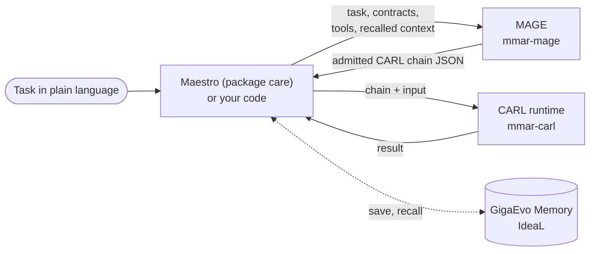

**MAGE** (Mesh Architecture Generation Engine, package `mmar-mage`) generates a
[CARL](/carl/getting-started/overview/) chain from a plain-language task. You
give it a task, and optionally an input schema, an exact output contract, a tool
catalogue and attached files. It returns chain JSON that the installed CARL
runtime has already loaded and checked.

MAGE does not run chains. CARL runs them. The usual host is Maestro (package
`care`): it collects the task, calls MAGE, checks the chain again, shows it to
you and runs it with CARL.

## What it gives you

- **Two modes.** `fast`: one model call writes the chain. `deep` (the
  default): four model stages (domain analysis, step plan, DAG, step
  descriptions), plus optional research and quality stages.
- **Admission before return.** Every chain passes deterministic lint and a
  typed load by the installed CARL runtime. One repair attempt is allowed;
  a chain that still fails is rejected, not returned.
- **Typed requests** (development line). A `GenerationRequest` separates the
  safe task from private context, carries an input schema and an exact output
  contract, and states what may leave the machine and what may be saved.
- **Natural-language edits** of an existing chain, applied to a copy and
  admitted the same way.
- **Optional memory**: recall of related saved chains from GigaEvo Memory and
  saving the result.
- **CLI**: `mage generate`, `mage edit`, `mage validate`, `mage evolve`,
  `mage version`.

## Versions and status

Three lines exist. The pages in this section label every capability with one
of them.

| Label | What it means | Where |
| --- | --- | --- |
| **Released** | In `mmar-mage` 0.1.3 on PyPI (June 2026). | Public repository `AIRI-MAESTRO/mage`, tag `v0.1.3`. |
| **Development line** | Package version `0.2.0`, not tagged, not on PyPI. Maestro pins a git revision of this line. | Branches of the development repository `Glazkoff/carl-mage`. |
| **Experimental** | The v3 generator, its memory loop, IdeaL loop and tool forges. Research code in `evaluation/`, not part of the package API. | Development branches `feat/v3-*`, not released, not merged. |

What Maestro actually runs is described in
[Maestro as host](/mage/integration/maestro-host/). The full list is in
[Capability status](/mage/reference/status/) and the
[changelog](/mage/reference/changelog/).

:::caution[The v3 generator is not in the package]
The plan, author, compile and dry-run generator called "v3", the IdeaL loop
and the code-tool forge live in the evaluation harness of a development
branch. `MAGEGenerator` does not call them, and the wheel does not ship the
`evaluation/` directory. They are documented under
[Concepts](/mage/concepts/v3-generator/) so you know where generation is
heading, not as something you can install.
:::

## What MAGE emits

`MAGEGenerator` writes 16 CARL step types: `llm`, `structured_output`, `tool`,
`mcp`, `mcp_resource`, `memory`, `transform`, `conditional`, `agent_skill`,
`evaluation`, `human_input`, `tool_discovery`, `agent_handoff`,
`parallel_sampling`, `supervisor`, `debate`. It does not write `code`,
`agent`, `map`, `command` or `wait` steps. The internal labels `eval` and
`aggregator` are lowered to `llm` before export. See
[the CARL step list](/carl/steps/overview/).

## Where to go next

- [Quick start](/mage/getting-started/quick-start/): install and generate a
  first chain.
- [Generation pipeline](/mage/concepts/pipeline/): what happens inside
  `fast` and `deep`.
- [Typed requests and admission](/mage/concepts/typed-authoring/).
- [Python API](/mage/integration/python-api/) and
  [Configuration](/mage/integration/configuration/).
