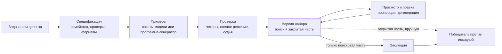

Эволюции нужен набор данных: примеры задач с эталонными ответами, по которым
оценивается каждая цепочка-кандидат. **Автобенчмарк** (внутри это *фабрика
бенчмарков*, в приложении экран **Наборы данных**) собирает такой набор для
цепочки или описания задачи, проверяет каждый пример и хранит результат как
версии набора. Их можно смотреть, править, перебалансировать и отдавать в
эволюцию.

:::caution[Ветка разработки]
Этот раздел описывает студию наборов данных из ветки разработки (черновой
pull request). В выпущенную сборку Maestro она ещё не входит. Подписи,
значения по умолчанию и имена инструментов до релиза могут измениться.
:::

## Цикл

1. **Спецификация.** Один вызов модели превращает задачу в спецификацию:
   цель, форматы входа и ответа, критерий успеха, 4–8 *семейств* примеров и
   правило проверки. Семейства отличаются решениями, которые должен принять
   агент, а не только именами и числами.
2. **Примеры.** Либо модель пишет примеры пакетами, либо один раз пишет
   небольшую *программу-генератор* на Python, и программа локально считает
   каждый пример и его эталон.
3. **Проверка.** Каждый пример проходит программные проверки, затем
   независимое слепое решение и, если нужно, вызов судьи. В набор попадают
   только подтверждённые. См. [Проверка ответов](/ru/care/autobench/checks/).
4. **Версия набора.** Принятые примеры сохраняются как версия
   `bf_<16 hex>.v<N>` с *поисковой* и *закрытой* частью, разбитыми по
   семействам.
5. **Просмотр.** Примеры можно править, принимать и исключать, добавлять
   свои, менять пропорции семейств и догенерировать недостающее.
6. **Эволюция.** В эволюцию уходит только поисковая часть. Закрытая остаётся
   в локальном хранилище для финальной проверки, которую пока делают вручную.
   См. [Набор в эволюции](/ru/care/autobench/evolution/).

## С чего начать

| Нужно | Страница |
| --- | --- |
| Сгенерировать набор в приложении | [Генерация набора](/ru/care/autobench/generate/) |
| Выбрать, как проверять ответы | [Проверка ответов](/ru/care/autobench/checks/) |
| Исправить примеры, поменять пропорции, добавить ещё | [Правка и пропорции](/ru/care/autobench/review/) |
| Проэволюционировать цепочку на наборе или взять свою таблицу | [Набор в эволюции](/ru/care/autobench/evolution/) |
| Настроить Codex или модель чата | [Провайдеры](/ru/care/autobench/providers/) |
| Управлять через агента | [Инструменты агента](/ru/care/autobench/tools/) |
| Узнать, что проверено, а что нет | [Ограничения и статус](/ru/care/autobench/limits/) |

## Термины

| Термин | Смысл |
| --- | --- |
| Процесс | Одна генерация, id `bf_<16 hex>`. Переживает перезапуск приложения. |
| Спецификация | План процесса. Каждая ваша инструкция создаёт новую версию. |
| Семейство | Группа примеров на один тип решения, со сложностью и весом. |
| Пример | Один вход со скрытым эталоном (и, возможно, допустимыми альтернативами). |
| Поисковая часть | Примеры, которые видит эволюция. |
| Закрытая часть | Целые семейства, спрятанные от эволюции для финальной проверки. |
| Версия | Зафиксированный набор принятых примеров с манифестом: проверка, оценщик, происхождение. |

## Это не `maestro dataset`

Наборы TUI и CLI (`maestro dataset …`, `/dataset …`) хранятся как карточки
памяти, это отдельная функция. См. [CLI: dataset](/ru/care/cli/dataset/).
Процессы и версии автобенчмарка лежат в своём локальном хранилище (см.
[Инструменты агента](/ru/care/autobench/tools/#хранилище)).
