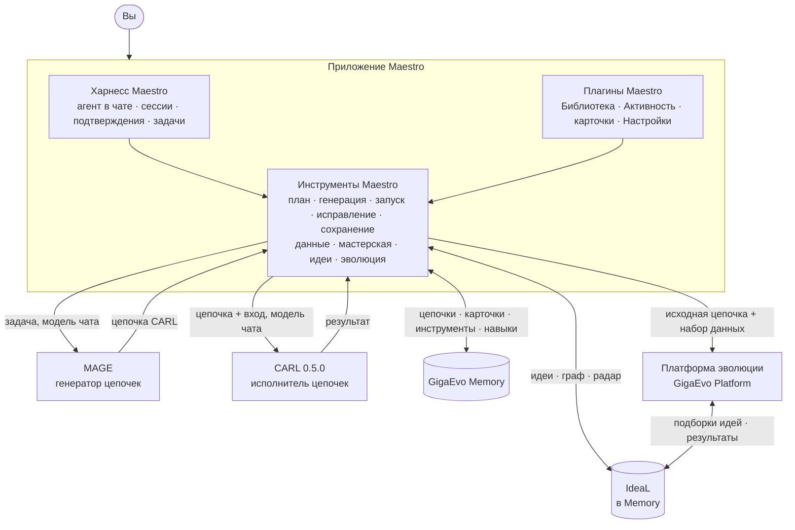

Maestro — пользовательский слой над стеком из отдельных модулей. Каждый
модуль отвечает за свой этап жизни цепочки.

| Часть | Пакет / сервис | Роль |
| --- | --- | --- |
| **Maestro** | `maestro-care` (импорт `care`) | Приложение (харнесс и плагины Maestro), слой инструментов, TUI и CLI. |
| **Харнесс Maestro** | входит в `Maestro.app` | Постоянный агент в чате: сессии, выбор модели, инструменты, подтверждения, фоновые задачи. |
| **MAGE** | `mmar-mage` | Превращает описание задачи в цепочку CARL. Работает внутри Maestro. |
| **CARL** | `mmar-carl` | Выполняет цепочки: типизированные шаги, зависимости, инструменты, MCP, навыки. См. [CARL](/ru/carl/getting-started/overview/) и его [журнал изменений](/ru/carl/reference/changelog/). |
| **GigaEvo Memory** | `gigaevo-client` + сервер Memory | Хранит цепочки (с версиями), карточки памяти, инструменты и навыки. |
| **IdeaL** | часть сервера Memory | Идеи по пространствам, их рейтинг по итогам эволюции, графы прогонов и радар. См. [IdeaL](/ru/ideal/getting-started/overview/). |
| **Платформа эволюции** | GigaEvo Platform (HTTP) | Эволюционирует цепочку на наборе данных со своими моделями мутации и валидации. |

## Внутри приложения

- **Харнесс** ведёт разговор: чат, выбор модели, очередь следующих
  сообщений, отмена, окно подтверждения и список задач.
- **Инструменты** Maestro работают в отдельном локальном процессе, который
  приложение запускает и останавливает вместе с окном. Они держат правила
  цепочек: артефакты, закреплённые по хэшу, входные контракты, квитанции,
  классы подтверждений.
- Приватный **мост модели чата** позволяет MAGE и CARL вызывать модель того
  чата, который вызвал инструмент. Ключ провайдера не покидает харнесс.
- **Политика подтверждений** стоит перед инструментами: платная работа
  спрашивает один раз, бесплатные действия проходят. См.
  [Подтверждения](/ru/care/app/confirmations/).

CLI и TUI используют тот же код предметной области, но без харнесса. Они
вызывают MAGE и CARL с настройками генератора `CARE_MAGE__*` вместо модели
чата.

## Путь данных: генерация → запуск → сохранение → эволюция

1. **План.** Вы описываете задачу. Агент строит план со стратегией
   (повторно использовать сохранённую цепочку, сгенерировать новую, написать
   самому, взять артефакт из этой сессии).
2. **Генерация.** MAGE строит цепочку на модели чата. Если память
   подключена, он сначала получает выборку похожих цепочек только для чтения
   (из каталога IdeaL, если память цепочек — IdeaL). Результат — артефакт
   цепочки, закреплённый по SHA-256, с карточкой структуры и сводкой
   готовности.
3. **Запуск.** CARL выполняет именно этот артефакт с вашими входными
   данными, проверенными по входному контракту цепочки. Шаги вызывают модель
   чата, инструменты, MCP-серверы или навыки (навыки в песочнице, по
   умолчанию Docker). Запуск можно ставить на паузу между шагами.
   Неудачный запуск можно исправить: Maestro предлагает новую цепочку и сам
   её не запускает.
4. **Сохранение.** Цепочка пишется в Memory новой версией и появляется в
   Библиотеке.
5. **Данные.** Генератор данных для эволюции создаёт примеры задач для
   цепочки, проверяет их и хранит версии набора с поисковой частью и скрытой
   закрытой частью. См. [Данные для эволюции](/ru/care/workflows/data-generation/).
6. **Эволюция.** Maestro отправляет исходную цепочку и поисковую часть
   набора на платформу эволюции. Если IdeaL включён, прогон несёт
   пространство и постоянный ключ задачи. Перед каждой мутацией платформа
   берёт подборку идей из IdeaL и возвращает проверенный результат. Статус,
   лучший результат и радар возвращаются в приложение. См.
   [Эволюция](/ru/care/workflows/evolution/).
7. **Обучение.** IdeaL обновляет рейтинги идей по результатам. Следующая
   генерация и следующая эволюция той же задачи начинаются с этим опытом.

Лучшая цепочка завершённой эволюции подготавливается в сессии как артефакт.
В Memory она **не** пишется автоматически. Сохраните её явно.

## Где хранится состояние

| Состояние | Где | Переживает перезапуск |
| --- | --- | --- |
| Цепочки, карточки памяти, инструменты, навыки | GigaEvo Memory | Да |
| Идеи, рейтинги идей, графы прогонов эволюции | IdeaL (сервер Memory) | Да |
| Эксперименты эволюции | Платформа эволюции | Да |
| Наборы данных для эволюции | Локальный SQLite (`CARE_BENCHMARK_FACTORY_DB`) | Да |
| Сессии и история чата | Каталог данных харнесса | Да |
| Фоновые задачи, список Активности в процессе, пауза цепочки, владение запуском | Процесс приложения | Нет |

## Мягкая деградация

Maestro импортирует MAGE, CARL и клиент платформы лениво, внутри функций,
которым они нужны. Отсутствующая необязательная часть даёт понятное
сообщение, а не падение при старте. Без Memory приложение по-прежнему
генерирует и запускает цепочки, но сохранение и Библиотека недоступны. Без
URL платформы недоступна эволюция.

## См. также

- [Приложение](/ru/care/app/overview/)
- [Конфигурация](/ru/care/configuration/overview/)
- [Релиз 0.5.0](/ru/care/reference/release-0-5-0/)
