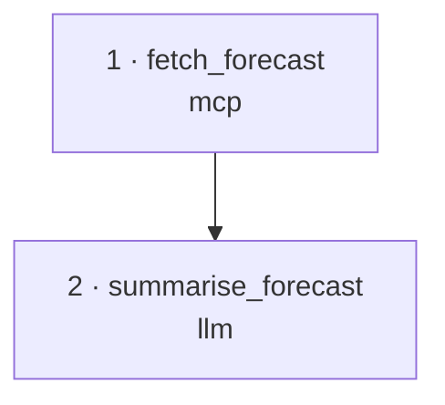

У Maestro два агентных навыка с одним именем `maestro`, для разных хостов:

| Навык | Где работает | Чем управляет Maestro |
| --- | --- | --- |
| **Переносимый навык CLI** | Claude Code, Codex, hermes, OpenClaw, CI | Командой `maestro` |
| **Встроенный навык приложения** | Агент внутри приложения Maestro | Собственными инструментами Maestro в приложении |

## Переносимый навык CLI

Бандл в формате [agentskills.io](https://agentskills.io). Он учит внешнего агента
работать с Maestro через [командную строку](/ru/care/cli/overview/): генерировать,
править, склеивать и запускать цепочки, смотреть Memory и версии, вести датасеты,
запускать эволюцию и деплой, настраивать решатели STARM, **объяснять и рисовать**
цепочки. Путь к Maestro нигде не зашит.

:::tip[Установка одной командой]
```bash
uvx maestro-install skill
```
Распаковывает навык для Claude Code, Codex, hermes или OpenClaw (выбор через
`--agent`). Подробно: [Установка и использование](/ru/care/skill/install/). Бандл
напрямую: [`maestro.skill`](https://airi-maestro.github.io/care-docs/maestro.skill).
:::

### Что в бандле

```
maestro/
├── SKILL.md                      # когда срабатывать, карта команд, сценарии, IdeaL, STARM
├── scripts/
│   ├── care.sh                   # переносимый запускатель, находит CLI
│   └── viz_chain.py              # JSON цепочки → граф Mermaid + таблица шагов
└── references/
    ├── commands.md               # все подкоманды и флаги (релиз 0.5.0)
    ├── production-and-tui.md     # Interactive и Production, slash-команды TUI
    ├── chain-format.md           # JSON цепочки: типы шагов, ссылки
    ├── interpret.md              # объяснение и визуализация цепочки
    └── integration.md            # встраивание в hermes / CI / другие хосты
```

### Что умеет агент с навыком

| Область | Команды |
| --- | --- |
| **Генерация / правка / запуск** | `generate`, `revise`, `compose`, `run` (preflight или `--execute` с `--input` / `--file`), `replay`, экспорт в `.json` / `.py` |
| **Memory и версии** | `memory ls/show/history`, `search`, `diff`, `lineage`, `favourite`, `versions`, `promote`, `rollback`, `forget`, `remember`, `notes` |
| **Проверка и перенос** | `validate`, `import [--apply]`, бандлы `export` |
| **Оценка и улучшение** | `dataset add/list/run/export`, `evolve … --wait --accept`, `catalog`, `marketplace` |
| **Выпуск** | `deploy`, `deployments`, `metrics` |
| **Настройка и диагностика** | `doctor` (включая проверку STARM), `init`, `migrate-secrets` |

Навык знает и то, без чего команды ломаются: `maestro` без подкоманды открывает
окно приложения, у каких команд нет `--json`, что `revise` и `compose` без `--yes`
только показывают результат, что индекс `search` в свежей Memory может быть пуст
(используйте `memory ls --q`), что пути к файлам нужны абсолютные. Он честно
перечисляет действия, которых нет в CLI (`/upload`, `/promote` с проверкой, работа с
IdeaL в приложении), и говорит с пользователем в терминах Maestro, а не внутренних
компонентов.

### Объяснение и визуализация

После генерации навык первым делом предлагает **объяснить и нарисовать** цепочку:
граф зависимостей рисует собственный `to_mermaid` среды исполнения (с критическим
путём и тепловыми картами токенов, задержки и стоимости, если есть запуск), а
каждый шаг описывается словами. Объясняет сам агент, поэтому ключ модели не нужен.
Например, цепочка погоды из двух шагов:



Дальше навык предлагает запустить цепочку на примере, поправить её словами или
запустить эволюцию.

### IdeaL в навыке CLI

Подкоманд IdeaL в CLI нет. Навык советует агенту работать с идеями в приложении,
объясняет, как получить подписанную ссылку на радар запуска по ключу API, как
подключить озеро к агенту через MCP и какие правила сохраняют честность рейтингов
идей (текст на английском, ссылаться только на применённые идеи, сообщать о
контрольных мутациях, не передавать ответы тестов и секреты).

### Переносимость

`scripts/care.sh` находит CLI одинаково везде:

1. глобальный `maestro` (или старый `care`) в `PATH`; shim ставит
   [`uvx maestro-install`](/ru/care/getting-started/quick-start/);
2. локальный checkout через `$CARE_HOME` или стандартные места (`uv run --frozen`,
   если есть lock-файл);
3. опубликованный пакет: `uvx --from maestro-care maestro`.

Если ничего не нашлось, запускатель печатает понятную подсказку, а не молча падает.

## Встроенный навык приложения

Пресет агента в приложении подключает свой навык `maestro`. Он работает только через
типизированные инструменты Maestro, никогда через CLI, и использует подключение к
модели чата, которое уже есть в приложении. Он покрывает:

- **Цепочки**: проверку возможностей (`maestro_capabilities`), план
  (`maestro_agent_plan`), генерацию фоновой задачей, просмотр сгенерированного
  артефакта, исполнение и не больше одного предложения починки после неудачного
  запуска.
- **Эволюцию**: подготовку исходной цепочки и настоящего датасета, поиск их по
  названию (`maestro_find_artifacts`), план и запуск, чтение результата.
- **IdeaL**: засев идей для задачи через `maestro_ideal_graph`, `maestro_idea_check`,
  `maestro_idea_translate` и `maestro_idea_save` после одобрения списка
  пользователем; правку и архивирование идей; радар запуска
  (`maestro_ideal_run_radar`), запуски цепочки (`maestro_ideal_chain_runs`) и
  принудительную подачу идеи в идущую эволюцию (`maestro_ideal_run_force`). Новые
  инструменты создаются в мастерской (`maestro_capability_draft` →
  `maestro_capability_save`).

Платные действия (генерация, починка, исполнение, старт эволюции) один раз
подтверждаются в диалоге самого приложения. Встроенный навык — часть приложения,
`maestro-install skill` его не ставит.
