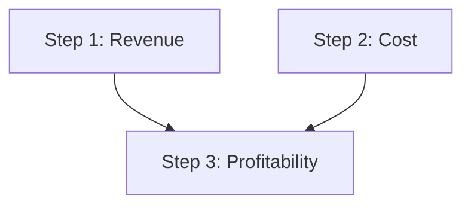

Несколько идей объясняют почти всё в CARL.

## ReasoningChain

**Цепочка** — это список описаний шагов и настройки исполнения: `max_workers`,
`fail_fast`, настройки поиска, метрики, политика RE-PLAN, таймаут, встроенные
цепочки-инструменты. Это основной публичный API; цепочка сериализуется в JSON и
обратно. См. [ReasoningChain](/ru/carl/chains/overview/).

## Шаги

**Шаг** — типизированное описание одной единицы работы. У всех шагов есть
`number`, `title`, `dependencies`, `triggered_by`, `metrics`, `cache`,
`loop_back_to` / `loop_config` и поля чекпойнтов RE-PLAN. Сверху каждый тип
добавляет свой config. Типов шагов 25: от одного вызова LLM до ограниченного
агентного цикла или команды в песочнице. См. [обзор шагов](/ru/carl/steps/overview/).

## Параллельное исполнение по DAG

Шаги объявляют `dependencies=[...]`. **DAGExecutor** раскладывает их на батчи.
Шаги без невыполненных зависимостей идут первыми и параллельно. Следующие батчи
ждут только то, от чего зависят.

```python
LLMStepDescription(number=1, title="Revenue analysis", aim="...", dependencies=[])
LLMStepDescription(number=2, title="Cost analysis",    aim="...", dependencies=[])
# Step 3 waits for both 1 and 2:
LLMStepDescription(number=3, title="Profitability",    aim="...", dependencies=[1, 2])
```



Шаг может ждать и **события** (`triggered_by`). Условный шаг пропускает ветки,
которые не выбрал.

Параллельные шаги работают с copy-on-write представлением памяти. Внутри батча
записи соседа не видны. После батча они сливаются в порядке номеров шагов: при
записи в один ключ побеждает шаг с бо́льшим номером. См.
[шаги памяти](/ru/carl/steps/memory/).

Упавший шаг не останавливает цепочку, если не включён
[fail-fast](/ru/carl/chains/run-controls/).

## Извлечение контекста

LLM-шаг может объявить `step_context_queries`. По каждому запросу CARL ищет в
`outer_context` (подстрокой или векторным поиском) и вставляет найденные
фрагменты в промпт шага. Так каждый шаг видит только нужный ему контекст.

## ReasoningContext и ReasoningResult

**Контекст** хранит состояние исполнения:

- вход: `outer_context` (текст для промптов) и, по желанию, `runtime_input`
  (структурированный вход хоста для ссылок вроде `$outer_context.user.city`);
- LLM-клиент (`api`), `language`, `system_prompt`;
- историю, память по пространствам имён, события, метаданные;
- реестр инструментов и колбэки;
- полномочия хоста: `command_policy`, возможности команд,
  `code_execution_policy`, сетевой enforcer, обработчик ввода от человека;
- управление запуском: пауза, возобновление, отмена.

Запуск цепочки возвращает **ReasoningResult**: `success`, `get_final_output()`,
результаты шагов, расход токенов, `metadata` и трассу исполнения.

## Цепочка просит, хост решает

Сериализованная цепочка — это вход, а не полномочия. В JSON цепочки можно
назвать инструмент, команду, профиль кода или песочницу. Можно ли это
запустить, решают объекты, которые хост передаёт в контекст во время запуска.
Они никогда не сериализуются. `chain.preflight(context)` заранее покажет, чего
не хватает.

:::tip
Динамические ссылки дают поздним шагам читать ранний вывод: `$history[-1]`,
`$memory.namespace.key`, `$outer_context.field`, `$steps.1.result_data` и
другие. См. [динамические ссылки](/ru/carl/chains/dynamic-references/).
:::
