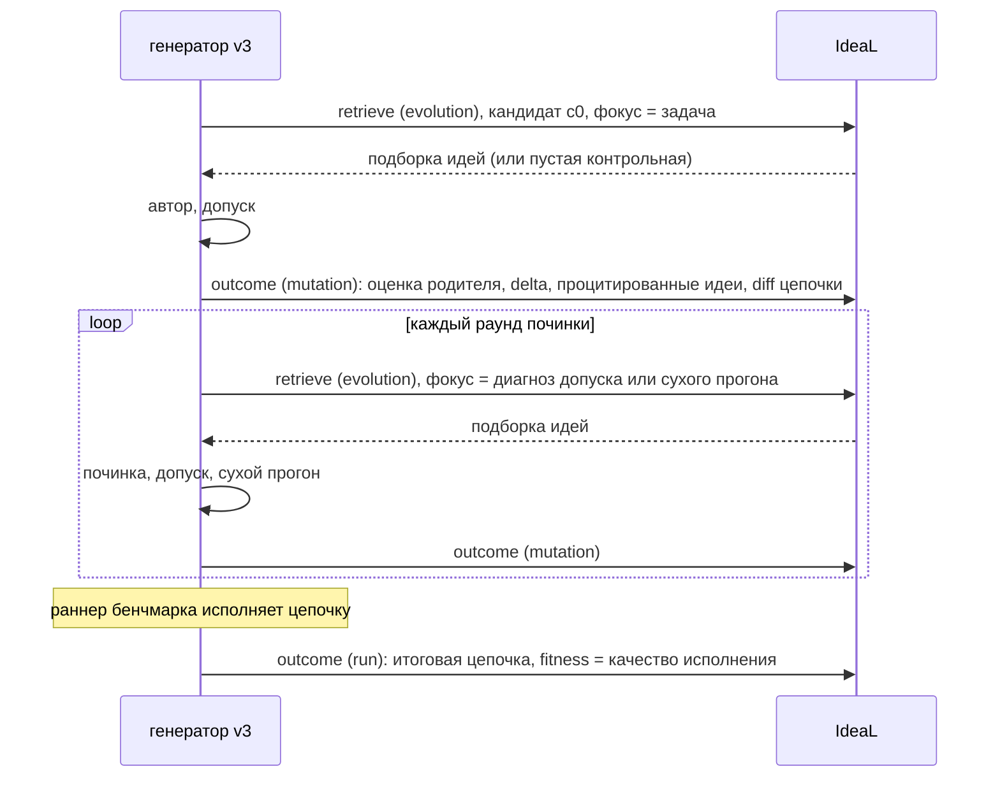

:::caution[Эксперимент]
Ветка `feat/v3-ideal-loop` (коммит ceaf38b, 2 ноября 2026), модуль
`mmar_mage/ideal_loop.py`, влит в кандидат 0.2.0. К
[генератору v3](/ru/mage/concepts/v3-generator/) подключается только из
рукавов MAGEBench в `evaluation/`; стратегия `generation_strategy="v3"` из
пакета его не использует. Проверен офлайн на поддельном сервере IdeaL; не измерен, не выпущен. Что
Maestro делает с IdeaL сегодня, описано в
[Памяти и переиспользовании](/ru/mage/concepts/memory/).
:::

## Идея

[IdeaL](/ru/ideal/getting-started/overview/) уже учится на эволюции: перед
каждой мутацией выдаёт подборку идей, после мутации записывает изменение
оценки и рейтингует идеи по этим итогам. Цикл смотрит на одну генерацию так
же:

| Эволюция | Генерация |
| --- | --- |
| Прогон | Одна генерация одной задачи |
| Мутация | Одна попытка написать или починить цепочку (кандидат) |
| Изменение оценки после мутации | Самопроверочная оценка кандидата |
| Лучшая цепочка прогона | Итоговая цепочка с качеством исполнения как fitness |

Новые эндпоинты на сервере не нужны. Контрольный рукав сервера (часть
подборок нарочно пустая) позволяет сравнить «с идеями» и «без идей» для
генерации так же, как для эволюции. См.
[Рейтинг и итоги](/ru/ideal/concepts/rating/).

## Одна генерация

- Каждая генерация начинается с retrieve в режиме evolution, даже если идеи
  не нужны: сервер привязывает итог мутации к пространству и задаче только
  через прогон, который регистрирует этот retrieve.
- Идеи фокусируются описанием задачи на `c0` и диагнозом на починках
  (`memory_loop_ideas_by: diagnosis`, по умолчанию) или всегда задачей
  (`query`).
- **Оценка кандидата**: 0, если не допущен; 0.5, если допущен; 0.5 + 0.5 ×
  доля пройденных фикстур после сухого прогона. В неё идут только
  самопроверки, оценщик бенчмарка в неё не попадает никогда.
- После исполнения итог прогона сохраняет финальную цепочку с тегом задачи,
  и каталог может отдать её следующей генерации той же задачи. Именно это
  читает лестница переиспользования.
- Сбой памяти никогда не роняет генерацию. Каждый вызов и его ошибка
  остаются в трассе (`memory_loop.calls`).

## Настройки

На рукав бенчмарка:

| Поле | По умолчанию | Значение |
| --- | --- | --- |
| `memory_loop` | `off` | `local`: только лестница. `ideal`: лестница и раунды IdeaL. |
| `memory_loop_store`, `memory_loop_namespace` | не заданы | Базовый URL IdeaL и пространство. |
| `memory_loop_chain_store` | `local` | Где лежат проверенные цепочки: локальный JSON или IdeaL (итоги прогонов и каталог). |
| `memory_loop_learn` | `true` | `false` замораживает озеро: идеи выдаются, ничего не отправляется. |
| `memory_loop_ideas_by` | `diagnosis` | Или `query`. |
| `memory_loop_ideas_k` | `3` | Сколько идей из подборки видит автор. |
| `memory_loop_reuse`, `memory_loop_ideas` | `true` | Выключить лестницу или идеи. |
| `memory_loop_exact_min_fitness`, `memory_loop_near_min_similarity`, `memory_loop_near_min_fitness` | `0.999`, `0.8`, `0.999` | Пороги переиспользования. |
| `memory_loop_near_mode` | `adapt` | Или `reuse_if_admits`; в живом тесте он вернул устаревший ответ и больше не по умолчанию. |

Ключ IdeaL берётся из `IDEAL_API_KEY` (заголовок `X-API-Key`).

## Что предполагается о сервере

Цикл написан по коду ветки сервера IdeaL `feat/ideal-v0` (коммит 210d2f1). Он
вызывает `POST /v1/ideal/retrieve` и `POST /v1/ideal/outcome`. С API IdeaL из
[справочника API](/ru/ideal/api/reference/) это не сверялось.

- Извлечение идей из итогов работает, только если на сервере включено
  извлечение и настроена LLM озера; по умолчанию выключено.
- Поиск только английский, поэтому стартовое озеро исследования на
  английском.
- Пространства создаются первой записью.

## См. также

- [Память и переиспользование](/ru/mage/concepts/memory/)
- [IdeaL: эволюция и озеро](/ru/ideal/maestro/evolution/)
