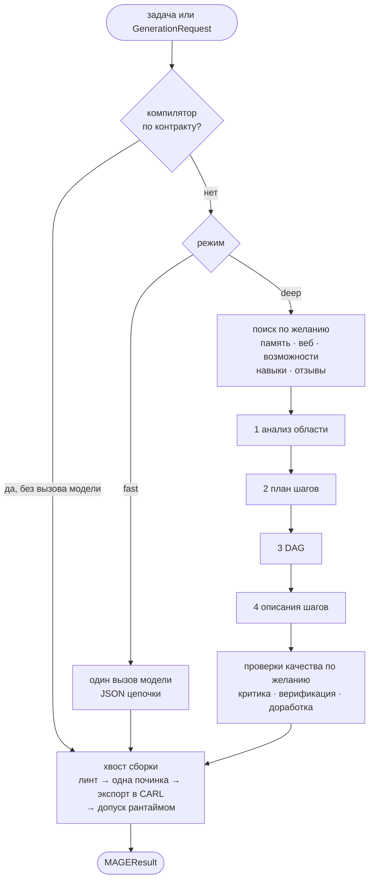

Здесь описан путь `legacy` в `MAGEGenerator.generate()`. Он стоит по
умолчанию в 0.1.3 и в ревизиях, которые закрепляет Maestro, поэтому Maestro
сегодня работает именно на нём. В кандидате 0.2.0 он уже не по умолчанию:
там `MAGEConfig()` запускает `v3`, а для legacy нужно
`generation_strategy="legacy"` (`mage generate --strategy legacy`). См.
[Стратегию v3](#стратегия-v3) ниже и [Генератор v3](/ru/mage/concepts/v3-generator/).

## Компилятор по контракту

**Ветка разработки.** До любого вызова модели MAGE смотрит, осталось ли что
решать. Если ровно один авторитетный инструмент с привязкой к рантайму,
точный контракт выхода с `value_source="single_tool_output"`, схема выхода
инструмента совпадает с контрактом и у каждого обязательного аргумента есть
детерминированная привязка, MAGE сам пишет цепочку из одного шага `tool`.
При любой неоднозначности запрос уходит в обычный конвейер. Переключатель:
`enable_contract_compiler` (включён).

## Режим fast

**Выпущено.** `mode="fast"`: один вызов модели с промптом на примерах
возвращает цепочку, с повторами (`max_retries`, по умолчанию 2). Дальше тот же
хвост сборки, что и в deep. Имя стадии: `fast_generation`.

## Режим deep

**Выпущено** (режим по умолчанию у стратегии legacy). Четыре стадии модели; у каждой есть
детерминированная замена, если стадию выключить:

| Стадия | Результат | Переключатель (по умолчанию) |
| --- | --- | --- |
| `domain_analysis` | Область, тип задачи, сложность, ключевые понятия. | `enable_domain_analysis` (вкл.) |
| `step_planning` | Упорядоченный список шагов. | `enable_step_planning` (вкл.) |
| `dag_building` | Зависимости и топология. | `enable_dag_optimization` (вкл.) |
| `step_describing` | Полные поля CARL для каждого шага. | `enable_step_descriptions` (вкл.) |

Всё остальное в deep **по умолчанию выключено**. Стадии есть в коде, их
можно включить в `MAGEConfig`, но ни один внутренний замер не показал, что
они улучшают цепочки. Включайте их только со своей оценкой; почти все
добавляют вызовы модели.

| Группа | Стадии | Переключатели |
| --- | --- | --- |
| Поиск (параллельно, до планирования) | `memory_research`, `web_research`, `capability_lookup`, `template_assembly`, `feedback_recall`, поиск навыков | `enable_memory_research`, `enable_web_research`, `enable_capability_lookup`, `enable_template_assembly`, `enable_feedback_loop`, `enable_skill_discovery` |
| Дополнения к плану | `needs_analysis`, `topology_selection`, `tot_planning`, `tool_synthesis`, `demo_bootstrap`, маршрутизация `fast_path` | `enable_needs_analysis`, `enable_topology_selection`, `enable_tot_planning`, `enable_tool_synthesis`, `enable_demo_bootstrap`, `enable_fast_path_routing` |
| Построение | `mcts_construction` | `enable_mcts` |
| Качество | `step_critique`, `chain_verification`, `self_refine` | `enable_step_critique`, `enable_chain_verification`, `enable_self_refine` |
| После сборки | `execution_feedback`, `benchmark_mode` | `enable_execution_feedback`, `enable_benchmark_mode` |

Если необязательная стадия падает, она сообщает `on_error`, и генерация идёт
дальше. Ошибки бюджета и отмена останавливают её всегда.

## Хвост сборки

Каждая цепочка из любого режима проходит через него перед выдачей:

1. **Линт.** Детерминированные проверки: шаги `tool` называют инструменты из
   каталога, привязки указывают на объявленные зависимости, ссылки
   `$history` и `$steps` разрешаются, преобразования исполнимы, финальный шаг
   совпадает с контрактом выхода.
2. **Одна починка.** При провале линта цепочка один раз уходит модели вместе
   с замечаниями. Починенный вариант остаётся, только если проходит линт.
3. **Экспорт в CARL.** `to_carl_compat()` переносит плоские поля MAGE в
   `step_config` каждого шага, а `eval` и `aggregator` превращает в `llm`.
   `reindex_history_refs()` переписывает `$history[N]` с номеров шагов на
   позиции, которые использует рантайм.
4. **Допуск рантаймом** (ветка разработки). `validate_runtime_chain()`:
   строгая схема, линт и типизированная загрузка установленным `mmar_carl`.
   Предупреждения о неразрешённых `$history` становятся ошибками. Цепочка, не
   прошедшая допуск, даёт `MAGEValidationError`; ничего не возвращается и не
   сохраняется.
5. **Имя.** Короткое отображаемое имя, описание и теги. Эвристическое имя
   есть всегда; при `enable_suggested_naming_llm` (вкл.) в deep его может
   заменить ещё один вызов модели.
6. **Сохранение.** Только для задачи-строки или
   `PersistencePolicy(mode="safe_projection_only")`, при включённом
   `enable_memory` и если в промпт планирования не попало ничего приватного.
   См. [Память и переиспользование](/ru/mage/concepts/memory/).

В 0.1.3 хвост уже проверяет имена инструментов, переиндексирует `$history` и
ловит вклейки ссылок в строки; шаг 4 появился на ветке разработки.

## Семантическая стратегия

**Ветка разработки, включается явно.** С `generation_strategy="semantic"`
(переменная `MAGE_GENERATION_STRATEGY`) `generate()` передаёт работу
`compile()`. Модель только толкует задачу и набрасывает абстрактный граф из
одного-шести действий, который может один раз поправить. Детерминированный код
привязывает возможности, переводит граф в CARL и прогоняет тот же хвост.
Затем готовность подтверждается по `RuntimeEnvironmentFeatures`, которые
объявляет хост; без объявления результат закрыт по умолчанию.

`compile()` не бросает исключение, а возвращает один из типизированных
исходов:

| Исход | Значение |
| --- | --- |
| `ReadyChain` | `result` (`MAGEResult`) и отчёт `readiness`. |
| `NeedsUserInput` | `requirements`: не хватает входа, возможности, учётных данных, функции рантайма, разрешения или уточнения. |
| `Unsupported` | `reasons`, почему задачу нельзя скомпилировать. |

`compile()` никогда не пишет в память. Maestro пользуется стратегией
`legacy`.

## Стратегия v3

**Кандидат 0.2.0, там она по умолчанию.** С `generation_strategy="v3"`
или в 0.2.0 без заданной стратегии `generate()` обходит режимы и необязательные стадии, описанные выше, а из
хвоста сборки пропускает починку и экспорт в CARL: цепочка v3 уже готовый
JSON CARL. Он запускает конвейер v3.4 из `mmar_mage/authoring/`: план потока
данных, один вызов-автор, который пишет CARL, детерминированный компилятор,
допуск с починками (не больше `v3_max_repairs`) и сухой прогон в настоящем
CARL с имитацией объявленных инструментов. Итоговая цепочка проходит тот же
линт и допуск `validate_runtime_chain`, включая `allowed_step_types`,
получает эвристическое имя, а
сохранение идёт по правилу из шага 6 хвоста. Для задач с приватным входом берите legacy: там v3 отклоняет любой
шаг `llm`. Подробности, ограничения и что остаётся экспериментом:
[Генератор v3](/ru/mage/concepts/v3-generator/). Maestro закрепляет более
старый MAGE и её не использует.

## Бюджеты и отмена

**Ветка разработки.** Жёсткие лимиты на одну генерацию в `MAGEConfig`:
`max_llm_calls`, `max_input_tokens`, `max_output_tokens`, `max_total_tokens`,
`max_wall_time_seconds`, `max_cost_usd`. MAGE падает с `MAGEBudgetError` до
того, как превысит лимит. При активном бюджете по токенам или деньгам расход
неудачной попытки неизвестен, поэтому повторы и запасные варианты отключаются.

Отмена: передайте `asyncio.Event` в `cancel`. Его проверяют между стадиями и
перед вызовами модели, MAGE бросает `MAGECancelledError`.

## См. также

- [Типизированные запросы и допуск](/ru/mage/concepts/typed-authoring/)
- [Python API](/ru/mage/integration/python-api/): обратные вызовы прогресса и имена стадий.
- [Динамические ссылки CARL](/ru/carl/chains/dynamic-references/)
