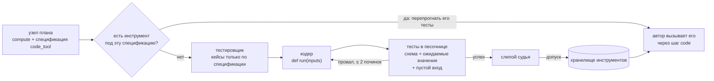

:::caution[Эксперимент]
Обе кузницы лежат на ветках разработки и работают только внутри
[генератора v3](/ru/mage/concepts/v3-generator/) в оценочном стенде.
`MAGEGenerator` их не использует. Ни одна не выпущена.
:::

Цепочка часто ломается не из-за плохого плана, а потому что шагу нужно
сделать то, что языковая модель делает плохо: вызвать настоящий API или
точно посчитать число из файла. Обе кузницы добавляют проверенную возможность
до того, как автор напишет цепочку, вместо надежды на шаг `llm`.

Правило у обеих одно: **тесты до допуска и слепой судья**. Судья не знает, кто
написал инструмент, и видит только его контракт, входы и выходы.

## Кузница API-инструментов

Пакет `mmar_mage/forge/`, поле рукава `forge_enabled`, с 9 октября 2026.

1. **Потребность.** План отмечает возможность, которую объявленные
   инструменты не покрывают.
2. **Источники.** Локальный каталог, APIs.guru (спецификации OpenAPI),
   официальный реестр MCP и необязательный хук веб-поиска. Источники отдают
   только метаданные; на этом этапе ничего не ставится и не запускается.
3. **Выбор.** Ранжирование BM25 до короткого списка, затем выбор одной
   операции.
4. **Адаптер.** Инструмент HTTP только на чтение из одной операции OpenAPI
   `GET` или инструмент удалённого MCP-сервера (исполняется встроенным
   MCP-клиентом CARL, если установлен SDK `mcp`).
5. **Тесты.** Предложенные тестовые вызовы записываются кассетами, чтобы
   повторные прогоны не ходили в сеть.
6. **Судья.** Слепая проверка записанного поведения, затем допуск в список
   возможностей, который видит автор.

:::note[Что измерено]
Первый замер 9 октября 2026 на небольшом наборе задач без инструментов:
поиск и выбор находили правильный API и операцию, но насквозь кузница не
сработала. Причины оказались инженерными (повторы при сбоях сети, судья
видел обрезанные ответы, тесты строились по чужим полям, сухой прогон
имитировал инструмент вместо настоящего вызова). Нового замера не было.
:::

## Кузница код-инструментов

Модуль `mmar_mage/code_forge.py`, поле рукава `code_forge`, коммит acf7091
(2 ноября 2026). Гипотеза H5 исследования памяти: недостающее точное
вычисление куётся один раз и переиспользуется внутри семейства задач.

1. Планировщик помечает точное вычисление по данным узлом `compute` со
   спецификацией `code_tool`: имя, общее назначение, типизированные входы и
   выходы.
2. **Сначала тесты.** Вызов-тестировщик, который не видит кода, пишет кейсы с
   точными ожидаемыми ответами только по спецификации.
3. **Код.** Вызов-кодер пишет одну чистую функцию `def run(inputs)`, только
   стандартная библиотека.
4. **Тесты в песочнице.** Все кейсы и кейс с пустым входом исполняются в
   песочнице шага `code` CARL. Выход должен пройти схему инструмента и
   совпасть с ожидаемым. Провалы уходят кодеру (по умолчанию две починки).
5. **Судья.** Проверяет, что во входах хватает данных, что код выводит
   ответы из входов (а не копирует их из тестов) и работает в общем случае.
   Может признать ошибочным не больше одного ожидания. Если судья винит
   спецификацию, кузница останавливается и узел возвращается автору.
6. **Хранение и переиспользование.** Принятый инструмент кладётся в
   локальное JSON-хранилище или в IdeaL как сущность `tool` (ключ
   `mage-code:<name>`, рантайм `carl-code`, файлы артефакта `run.py` и
   `tool.json`, при чтении сверяется хеш). Следующие задачи получают
   карточку на каждый сохранённый инструмент.

В цепочке автор вызывает инструмент шагом `code`, у которого источник
`$memory.tools.<name>`. Компилятор вставляет проверенную программу шагом
записи в `memory`, так что цепочка несёт свой код и остаётся
самодостаточной при переиспользовании. После исполнения раннер считает
использования и успехи; инструмент, дважды использованный без успеха,
понижается.

Настройки по умолчанию (`ForgeSettings`): не больше 2 инструментов и 10
вызовов модели на генерацию, 2 починки, 300 с, судья включён. У кузницы свой
клиент модели и свой бюджет, отдельно от бюджета генерации.

### На какие факты рантайма опирается

- Шаг `code` CARL принимает в `input_mapping` только ссылки на контекст,
  поэтому компилятор выносит каждый постоянный аргумент в отдельный шаг
  записи в память.
- Программу нельзя вписать прямо в шаг: `source` должен быть ссылкой,
  поэтому она живёт в шаге записи в память, который выполняется первым и
  никогда не бывает финальным.
- Каталог IdeaL отдаёт не больше одного инструмента на запрос, а код
  инструмента IdeaL хранит только как артефакт в git-хранилище сервера. Без
  настроенного хранилища запись падает, и инструмент остаётся в локальной
  копии.

### Песочницы

| Рантайм | Для чего |
| --- | --- |
| `docker` | Замеры. Без сети, только чтение, 256 МБ, 1 CPU, 32 процесса. |
| `local-seatbelt` | Только разработка на macOS: `sandbox-exec`, без сети, запись только в рабочей папке, каталоги с секретами не читаются. Время ограничено; CPU, память и число процессов нет. |
| `local-double` | Обычный подпроцесс, только для юнит-тестов. |

:::note[Что измерено]
Пока ничего. Кузницу прогнали насквозь на нескольких задачах разработки с
сильной моделью, которая решала их и без кузницы. Эти прогоны показывают, что
конвейер работает, но не что он помогает. Для замера нужны Docker и платные
вызовы модели.
:::

## См. также

- [Шаг code в CARL](/ru/carl/steps/code/)
- [Инструменты и граф IdeaL](/ru/ideal/concepts/tools-and-graph/)
