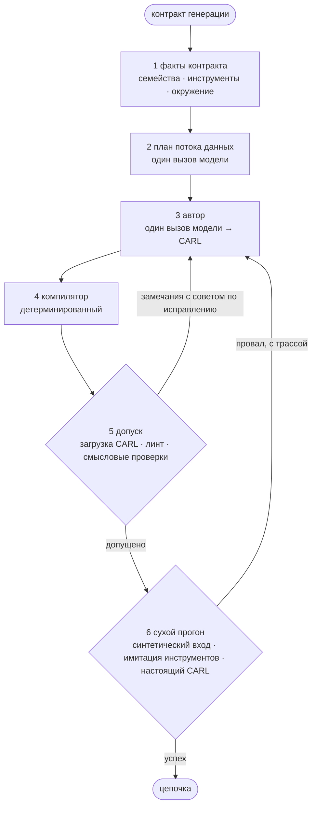

:::caution[Кандидат 0.2.0, стратегия по умолчанию, проверен только смоуком]
В кандидате `mmar-mage` 0.2.0 (ветка `prep/mage-0.2.0`, черновик PR
`Glazkoff/carl-mage#21`), которого **пока нет на PyPI**, v3 стоит **по
умолчанию**: `MAGEConfig()`, `MAGEConfig.from_env()` и `mage generate` без
`--strategy` запускают генератор v3.4 из `mmar_mage/authoring/`. Старый
конвейер fast/deep остаётся: `generation_strategy="legacy"`. Стратегию из пакета
проверяли офлайн-тестами, сценарным смоук-тестом колеса и живым смоуком на
модели Codex; заново на MAGEBench её не замеряли. Живой смоук 13 ноября 2026 на локальной модели Codex CLI (`gpt-6-luna`; это проверка работоспособности, не замер): через `MAGEGenerator` с исполнением в CARL 0.5.2 три задачи хоста из трёх дали верный ответ; рукав бенчмарка на 7 задачах lite сгенерировал и допустил 7 цепочек из 7, оценку прошли 3 из 7. Maestro закрепляет более старый MAGE и её не использует. Память генерации, цикл
IdeaL и кузницы инструментов остаются экспериментом, см.
[Что остаётся экспериментом](#что-остаётся-экспериментом).
:::

v3 заменяет четыре жёсткие стадии deep коротким общим процессом: спланировать
поток данных, дать одному вызову-автору написать CARL, а потом проверить
результат детерминированным кодом и сухим прогоном в настоящем рантайме CARL.



## Стадии

1. **Факты контракта.** Только из контракта генерации: семейства задач
   (правка, ответ по источникам, закрытый мир, файлы, инструменты,
   приватность), объявленные инструменты и MCP-серверы, окружение (например,
   может ли человек ответить на `human_input`). Каждое семейство добавляет в
   промпт короткое руководство.
2. **План потока данных.** Один вызов называет несколько узлов, нужных для
   ответа: что каждый потребляет и выдаёт и какой объявленный инструмент
   вызывает. Узел, результат которого никто не использует, запрещён, поэтому
   план минимален по построению. Если вызов плана упал, автор пишет цепочку
   без плана.
3. **Автор.** Один вызов раскладывает узлы по шагам CARL, опираясь на
   карточки шагов и типы шагов, которые умеет загружать установленный CARL.
4. **Компилятор.** Детерминированный: убирает переопределения модели
   (`llm_config`), нормализует ссылки (`$steps.N.result.x` →
   `$steps.N.result_data.x`), удаляет мёртвые шаги, подгоняет финальный шаг
   под контракт выхода или под формат ответа, названный в запросе.
5. **Допуск и починка.** Типизированная загрузка CARL, линт и общие
   смысловые проверки. У каждого замечания есть конкретный совет, и оно
   уходит автору, не больше `v3_max_repairs` раз (3).
6. **Сухой прогон.** Тестовые входы синтезируются по контракту, объявленные
   инструменты имитирует модель по их схемам, цепочка исполняется в
   настоящем CARL, прогон проверяется детерминированно. Провал сухого
   прогона даёт ещё один раунд починки с трассой исполнения. Настоящие
   инструменты хоста не вызываются никогда; цепочку с шагом, который нельзя
   сымитировать, не запускают. Можно включить рецензента в свежем контексте,
   в v3.4 он выключен.

Значения по умолчанию взяты из измеренной версии **v3.4**: один раунд сухого
прогона на двух тестовых входах, до двух починок после него, рецензент
выключен, температура 0. Поля перечислены в
[Настройках](/ru/mage/integration/configuration/#стратегия-v3).

## Как выбрать стратегию

```python
from mmar_mage import MAGEConfig, MAGEGenerator

generator = MAGEGenerator(MAGEConfig(api_key="sk-..."))   # v3, по умолчанию
result = await generator.generate(request, capabilities=..., runtime_features=...)

legacy = MAGEGenerator(MAGEConfig(generation_strategy="legacy", api_key="sk-..."))
```

Полный пример с инструментом и контрактом выхода есть в
[Быстром старте](/ru/mage/getting-started/quick-start/#стратегия-v3).

| Где | v3 (по умолчанию) | legacy |
| --- | --- | --- |
| Python | `MAGEConfig()` | `MAGEConfig(generation_strategy="legacy")` |
| Окружение, через `MAGEConfig.from_env()` | не задано или `MAGE_GENERATION_STRATEGY=v3` | `MAGE_GENERATION_STRATEGY=legacy` |
| CLI | `mage generate "..."` | `mage generate "..." --strategy legacy` |

Кое-где `legacy` выбирается сам. `benchmark_profile` включает его, если
стратегия не задана: настройки профиля управляют планировщиком legacy.
Готовые пресеты `configs/*.toml` и примеры задают
`generation_strategy = "legacy"`, а `mage evolve` и исследовательские рукава
в `evaluation/` закрепляют его, чтобы прежние замеры воспроизводились на том
же конвейере.

### Что меняется для хоста, который полагался на старое значение

- `mode` (`fast` / `deep`) и переключатели стадий deep действуют только в
  `legacy`, v3 их не читает. Один `MAGEConfig(mode="fast")` теперь запускает
  v3.
- Без `capabilities` у v3 нет инструментов (закрытый мир). Путь legacy
  находил инструменты и навыки в памяти и в локальном каталоге.
- v3 отклоняет задачи с приватным входом (см.
  [Известные ограничения](#известные-ограничения)); для них берите `legacy`.
- Генерация стоит больше вызовов модели: план, автор, починки и сухой прогон.
- `allowed_step_types` проверяется при допуске, так что список разрешённых
  шагов хоста работает и в v3.

Что делает `generate()` при `generation_strategy="v3"`:

- **Контракт.** `build_v3_contract(request, capabilities, runtime_features)`
  превращает `GenerationRequest` в контракт, который читает v3, с учётом
  политики выдачи данных запроса. Инструкции проекта, личные предпочтения и
  найденный контекст попадают туда, только если политика это разрешает;
  локальные пути и хеши приложенных файлов не попадают никогда; поля с
  пометкой `x-mage-data-classification: private` даже не называются. Задача
  строкой считается запросом с `runtime_input_schema={"type": "string"}`.
- **Закрытый мир.** `capabilities` и есть весь набор инструментов, который
  может использовать v3. Без него набор пуст: ни один шаг tool, MCP или
  навыка не пройдёт допуск.
- **Один клиент.** Все вызовы (план, автор, починки, тестовые входы,
  собственные шаги модели в цепочке и имитация инструментов в сухом прогоне)
  идут через `LLMClient` генератора, так что бюджеты, отмена, повторы и учёт
  расхода работают.
- **Тот же финальный допуск.** Цепочка проходит `validate_runtime_chain` со
  схемой входа, контрактом выхода и `human_input_callback_available` из
  запроса и с `allowed_step_types` (его проверяют и в каждом раунде
  починки), затем загрузку в CARL. Если цепочка так и не прошла допуск,
  выбрасывается `MAGEValidationError`.
- **Сохранение** по правилу legacy: только для задачи строкой или
  `PersistencePolicy(mode="safe_projection_only")`, при включённом
  `enable_memory` и без приватного в контексте планирования.

Проваленный сухой прогон генерацию не роняет. Возвращается последняя
допущенная цепочка, а `result.metadata.verification_passed` говорит, прошёл
ли последний сухой прогон (`None`, если прогон выключен или пропущен). При
одном раунде цепочку, починенную после провала, повторно не прогоняют. Трасса
процесса (план, действия компилятора, попытки с замечаниями, сухие прогоны)
лежит в `result.intermediate_artifacts["v3"]`. Стадии прогресса: `v3_plan`,
`v3_author`, `v3_dry_run`. `return_candidates=True` возвращает список из
одного результата.

## Известные ограничения

v3.4 подгоняли под контракты MAGEBench. Для настоящего хоста:

- Руководства по семействам задач выбираются по именам свойств схемы входа
  (`chain` + `edit_instruction`, `sources`, `evidence`, `files`, любой
  объявленный инструмент). Схема с другими именами руководства не получит.
- Подгонка финального шага под формат из запроса смотрит только на поле
  `request`, `query` или `question`.
- Файлы на входе следуют соглашению бенчмарка `$outer_context.files.<name>`;
  если в схеме хоста нет `files`, допуск такие ссылки отклонит.
- Компилятор убирает `llm_config` из каждого шага, поэтому v3 не умеет
  ограничивать вход LLM. Если в схеме входа есть хоть одно приватное поле,
  любой шаг `llm` отклоняется, на любом CARL. **Для задач с приватным входом
  берите стратегию legacy.**
- Найденный контекст кладётся в контракт по политике, но промпты v3.4 его не
  читают.
- Сухой прогон тратит вызовы модели: составление тестовых входов, собственные
  шаги модели в цепочке и по вызову на каждую имитацию инструмента на каждый
  тестовый вход. `v3_dry_run_rounds=0` его выключает.
- Если `human_input_callback_available` не объявлен, v3 считает, что на
  `human_input` ответить некому.

## Что остаётся экспериментом

Эти расширения подключаются к конвейеру v3 только из `evaluation/`, через
точки расширения `V3Hooks`, в рукавах MAGEBench. Стратегия из пакета никаких
хуков не передаёт. Их модули (`mmar_mage/generation_memory.py`,
`mmar_mage/ideal_loop.py`, `mmar_mage/forge/`, `mmar_mage/code_forge.py`)
`MAGEGenerator` не вызывает, и в публичный API они не входят.

| Расширение | Поле рукава | Страница |
| --- | --- | --- |
| Память генерации (примеры, идеи) | `memory_mode` | [Память и переиспользование](/ru/mage/concepts/memory/) |
| Лестница переиспользования и генерация как прогон IdeaL | `memory_loop` | [Цикл IdeaL](/ru/mage/concepts/ideal-loop/) |
| Шаги `code`, которые пишет автор | `code_profile` | [Кузницы инструментов](/ru/mage/concepts/tool-forge/) |
| Кузница API-инструментов | `forge_enabled` | [Кузницы инструментов](/ru/mage/concepts/tool-forge/) |
| Кузница код-инструментов по пробелам | `code_forge` | [Кузницы инструментов](/ru/mage/concepts/tool-forge/) |

Шагам `code` нужны профиль песочницы и рантайм (для замеров Docker), которых
в пакете нет.

## В оценочном стенде

Рукав MAGEBench `plan_author_v3` запускает тот же код из пакета
(`mmar_mage.authoring.generate_v3`); `evaluation/plan_author_v3.py` только
адаптер, который добавляет настройки рукава и исследовательские хуки. Если
все расширения выключены, рукав в точности совпадает со стратегией из
пакета. `preflight` бесплатен: он проверяет набор и конфиг прогона и печатает
потолки вызовов и стоимости, не обращаясь к провайдеру.

```bash
python -m evaluation.magebench_runner preflight \
  --suite evaluation/suites/magebench_families_v1_dev.json \
  --config evaluation/families/configs/fam-pilot-glm-o1.json --no-persist

# платно: настоящие вызовы провайдера, без --allow-external раннер откажется
python -m evaluation.magebench_runner run \
  --suite ... --config ... --allow-external
```

Рукав в конфиге выглядит как `{"kind": "plan_author_v3", ...}` с полями
вроде `author_max_repairs`, `author_dry_run_rounds`,
`author_dry_run_fixtures`, `author_dry_run_judge`. Команда `preflight` выше
запускалась на `prep/mage-0.2.0` (651b8de).

## Что измерено

Внутренние замеры на наборах MAGEBench, октябрь 2026, две модели. Они шли
через рукав бенчмарка, ещё до переноса кода в пакет:

- На наборе разработки v3.4 оказалась лучшей версией.
- На 42 отложенных задачах, под которые ни одну версию не подгоняли, v3.4 не
  хуже предыдущей версии (v2.2), разница в пределах шума.
- Скелеты из памяти, шаги `code` от автора и кузница API-инструментов в
  первом замере прироста не дали.

Цикл памяти, цикл IdeaL и кузница код-инструментов не измерялись. Их только
прогнали насквозь на нескольких задачах разработки. Стратегию из пакета на
запросах хоста не измеряли.

## См. также

- [Конвейер генерации](/ru/mage/concepts/pipeline/): путь `legacy`.
- [Типизированные запросы и допуск](/ru/mage/concepts/typed-authoring/)
- [Журнал изменений](/ru/mage/reference/changelog/)
