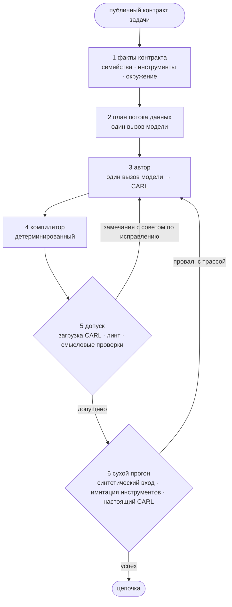

:::caution[Эксперимент, в пакет не входит]
v3 лежит в `evaluation/plan_author_v3.py` на ветках разработки
`feat/v3-phase0` и `feat/v3-ideal-loop`. Он работает только как рукав
раннера MAGEBench. `MAGEGenerator` его не вызывает, колесо `mmar-mage` не
включает `evaluation/`, Maestro его не использует.
:::

v3 заменяет четыре жёсткие стадии deep коротким общим процессом: спланировать
поток данных, дать одному вызову-автору написать CARL, а потом проверить
результат детерминированным кодом и сухим прогоном в настоящем рантайме CARL.



## Стадии

1. **Факты контракта.** Только из публичного контракта: семейства задач
   (правка, ответ по источникам, закрытый мир, файлы, инструменты,
   приватность), объявленные инструменты и MCP-серверы, окружение (например,
   может ли человек ответить на `human_input`). Каждое семейство добавляет в
   промпт короткое руководство.
2. **План потока данных.** Один вызов называет несколько узлов, нужных для
   ответа: что каждый потребляет и выдаёт и какой объявленный инструмент
   вызывает. Узел, результат которого никто не использует, запрещён, поэтому
   план минимален по построению.
3. **Автор.** Один вызов раскладывает узлы по шагам CARL, опираясь на
   карточки шагов и типы шагов, которые умеет загружать установленный CARL.
4. **Компилятор.** Детерминированный: убирает переопределения модели,
   нормализует ссылки (`$steps.N.result.x` → `$steps.N.result_data.x`),
   удаляет мёртвые шаги, подгоняет финальный шаг под контракт выхода или под
   формат ответа, названный в запросе.
5. **Допуск и починка.** Типизированная загрузка CARL, линт и общие
   смысловые проверки. У каждого замечания есть конкретный совет, и оно
   уходит автору. В измеренной конфигурации до трёх починок.
6. **Сухой прогон.** Вход синтезируется по публичному контракту, объявленные
   инструменты имитирует модель по их схемам, цепочка исполняется в
   настоящем CARL, прогон проверяется детерминированно. Провал сухого
   прогона даёт ещё один раунд починки с трассой исполнения. Можно включить
   рецензента в свежем контексте; в измеренной версии он выключен.

Измеренная версия: **v3.4**. Один раунд сухого прогона на двух фикстурах, до
двух починок после него, рецензент выключен.

## Дополнения на `feat/v3-ideal-loop`

Каждое включается в отдельном рукаве бенчмарка и является **экспериментом**:

| Дополнение | Поле рукава | Страница |
| --- | --- | --- |
| Память генерации (примеры, идеи) | `memory_mode` | [Память и переиспользование](/ru/mage/concepts/memory/) |
| Лестница переиспользования и генерация как прогон IdeaL | `memory_loop` | [Цикл IdeaL](/ru/mage/concepts/ideal-loop/) |
| Шаги `code`, которые пишет автор | `code_profile` | [Кузницы инструментов](/ru/mage/concepts/tool-forge/) |
| Кузница API-инструментов | `forge_enabled` | [Кузницы инструментов](/ru/mage/concepts/tool-forge/) |
| Кузница код-инструментов по пробелам | `code_forge` | [Кузницы инструментов](/ru/mage/concepts/tool-forge/) |

Шагам `code` нужна сборка CARL с этим шагом и песочница (для замеров Docker).
В CARL, который закрепляет ветка разработки MAGE, этого шага нет.

## Запуск

Только через раннер MAGEBench, из клона ветки. `preflight` бесплатен: он
проверяет набор и конфиг прогона и печатает потолки вызовов и стоимости, не
обращаясь к провайдеру.

```bash
python -m evaluation.magebench_runner preflight \
  --suite evaluation/suites/magebench_families_v1_dev.json \
  --config evaluation/families/configs/fam-pilot-glm-o1.json --no-persist

# платно: настоящие вызовы провайдера, без --allow-external раннер откажется
python -m evaluation.magebench_runner run \
  --suite ... --config ... --allow-external
```

Рукав в конфиге выглядит как `{"kind": "plan_author_v3", ...}` с полями
вроде `author_max_repairs`, `author_dry_run_rounds`,
`author_dry_run_fixtures`, `author_dry_run_judge`. На вход идёт контракт
задачи бенчмарка (`runtime_input_schema`, `capability_fixture`, контракт
выхода), а не свободный текст.

Команда `preflight` выше запускалась на `feat/v3-ideal-loop` (acf7091).
Юнит-тесты v3, цикла памяти и обеих кузниц на этом коммите проходят офлайн.

## Что измерено

Внутренние замеры на наборах MAGEBench, октябрь 2026, две модели:

- На наборе разработки v3.4 оказалась лучшей версией.
- На 42 отложенных задачах, под которые ни одну версию не подгоняли, v3.4 не
  хуже предыдущей версии (v2.2), разница в пределах шума.
- Скелеты из памяти, шаги `code` от автора и кузница API-инструментов в
  первом замере прироста не дали.

Цикл памяти, цикл IdeaL и кузница код-инструментов не измерялись. Их только
прогнали насквозь на нескольких задачах разработки.

## Почему этого ещё нет в пакете

v3 принимает контракт бенчмарка, а не `GenerationRequest`, для сухого прогона
и имитации инструментов опирается на оценочный стенд, а его дополнениям нужен
невыпущенный CARL. Перенос v3 за `MAGEGenerator` ещё впереди.

## См. также

- [Конвейер генерации](/ru/mage/concepts/pipeline/): путь, доступный сегодня.
- [Журнал изменений](/ru/mage/reference/changelog/)
