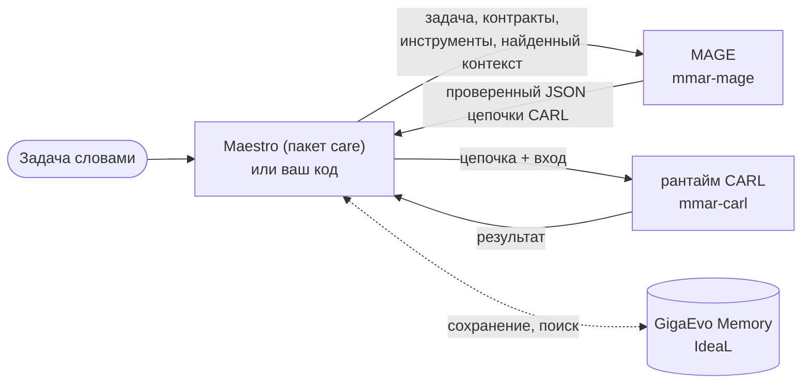

**MAGE** (Mesh Architecture Generation Engine, пакет `mmar-mage`) строит
цепочку [CARL](/ru/carl/getting-started/overview/) по задаче на обычном языке.
На вход идёт задача, а по желанию ещё схема входа, точный контракт выхода,
каталог инструментов и приложенные файлы. На выходе JSON цепочки, который
установленный рантайм CARL уже загрузил и проверил.

Сам MAGE цепочки не запускает, это делает CARL. Обычно MAGE вызывает Maestro
(пакет `care`): он собирает задачу, зовёт MAGE, ещё раз проверяет цепочку,
показывает её вам и запускает в CARL.

## Что умеет

- **Два режима.** `fast`: цепочку пишет один вызов модели. `deep` (по
  умолчанию): четыре стадии модели (анализ предметной области, план шагов,
  DAG, описания шагов) и необязательные стадии поиска и проверки качества.
- **Допуск до выдачи.** Каждая цепочка проходит детерминированный линт и
  типизированную загрузку установленным CARL. Есть одна попытка починки;
  если цепочка всё равно не проходит, её отклоняют, а не возвращают.
- **Типизированные запросы** (ветка разработки). `GenerationRequest` отделяет
  безопасную формулировку задачи от приватного контекста, несёт схему входа и
  точный контракт выхода и говорит, что можно отправлять наружу и что можно
  сохранять.
- **Стратегия v3** (кандидат 0.2.0, включается явно).
  `generation_strategy="v3"` планирует поток данных, даёт модели написать
  CARL, чинит цепочку по замечаниям допуска и прогоняет её всухую в CARL с
  имитацией инструментов. См. [Генератор v3](/ru/mage/concepts/v3-generator/).
- **Правка словами** готовой цепочки: изменения применяются к копии и
  проходят тот же допуск.
- **Память по желанию**: поиск похожих сохранённых цепочек в GigaEvo Memory и
  сохранение результата.
- **CLI**: `mage generate`, `mage edit`, `mage validate`, `mage evolve`,
  `mage version`.

## Версии и статус

Линий три. На страницах этого раздела у каждой возможности стоит одна из
меток.

| Метка | Что значит | Где |
| --- | --- | --- |
| **Выпущено** | Есть в `mmar-mage` 0.1.3 на PyPI (июнь 2026). | Публичный репозиторий `AIRI-MAESTRO/mage`, тег `v0.1.3`. |
| **Ветка разработки** | Версия пакета `0.2.0`, на PyPI нет. Кандидат в релиз (ветка `prep/mage-0.2.0`, черновик PR `Glazkoff/carl-mage#21`) готов к публикации; Maestro закрепляет более старые git-ревизии этой линии. | Ветки репозитория разработки `Glazkoff/carl-mage`. |
| **Эксперимент** | Исследовательские расширения генератора v3: память генерации, цикл IdeaL, кузницы инструментов, шаги `code` от автора. К v3 они подключаются только из `evaluation/`, в API пакета не входят. | Ветки разработки; влиты в `prep/mage-0.2.0`, но `MAGEGenerator` их не вызывает. |

Что именно запускает Maestro, описано на странице
[Maestro как хост](/ru/mage/integration/maestro-host/). Полный список в
[Статусе возможностей](/ru/mage/reference/status/) и в
[журнале изменений](/ru/mage/reference/changelog/).

:::caution[Стратегия v3 включается явно и ещё не выпущена]
Генератор «план, автор, компилятор, сухой прогон», который называют v3,
входит в кандидат 0.2.0 как `MAGEConfig(generation_strategy="v3")`. По
умолчанию остаётся `legacy`, 0.2.0 пока нет на PyPI, а стратегию из пакета
проверяли только офлайн, без запуска с настоящей моделью. Maestro её не
использует. Исследовательские расширения (цикл IdeaL, кузница
код-инструментов и другие) остаются экспериментом. См.
[Генератор v3](/ru/mage/concepts/v3-generator/).
:::

## Что выдаёт MAGE

Со стратегией по умолчанию `legacy` `MAGEGenerator` пишет 16 типов шагов CARL: `llm`, `structured_output`,
`tool`, `mcp`, `mcp_resource`, `memory`, `transform`, `conditional`,
`agent_skill`, `evaluation`, `human_input`, `tool_discovery`,
`agent_handoff`, `parallel_sampling`, `supervisor`, `debate`. Шагов `code`,
`agent`, `map`, `command` и `wait` он не пишет. Внутренние метки `eval` и
`aggregator` перед экспортом превращаются в `llm`. См.
[список шагов CARL](/ru/carl/steps/overview/).

## Куда дальше

- [Быстрый старт](/ru/mage/getting-started/quick-start/): установка и первая
  цепочка.
- [Конвейер генерации](/ru/mage/concepts/pipeline/): что происходит внутри
  `fast` и `deep`.
- [Типизированные запросы и допуск](/ru/mage/concepts/typed-authoring/).
- [Python API](/ru/mage/integration/python-api/) и
  [Настройки](/ru/mage/integration/configuration/).
